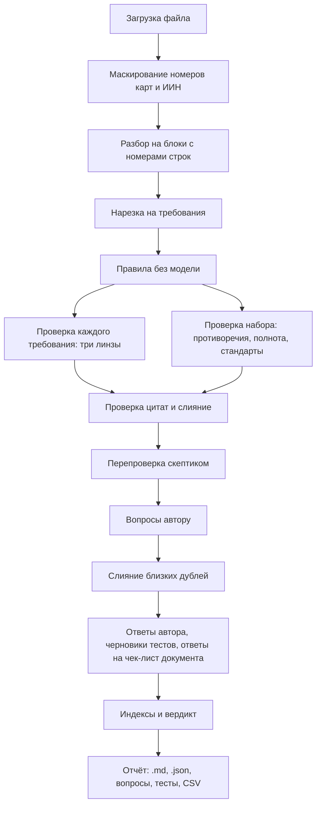

# Ревизор ТЗ

Агент, который до начала разработки проверяет документ с требованиями и пишет отчёт на русском языке.

Он нужен аналитику, разработчику и тестировщику. Ручная проверка занимает часы, а дефект, найденный поздно, превращается в переделку. Ревизор читает документ, находит двусмысленности, противоречия, пропуски и непроверяемые места. Затем он задаёт автору те вопросы, которые задал бы опытный проверяющий. В конце даёт вердикт: можно ли начинать работу.

Что умеет:

- **Каждая цитата в отчёте проверена программой.** Если модель привела фразу, которой нет в документе, замечание выбрасывается, а число таких случаев показывается в паспорте прогона.
- **Вердикт считает программа, а не модель.** Есть блокер (CRITICAL) — «начинать нельзя». Нет блокеров, но есть существенные замечания (MAJOR) — «после правок». Иначе — «можно».
- **Диалог с автором ТЗ.** Агент пишет анкету с вопросами и вариантами ответа. Автор отвечает, агент пересчитывает отчёт и показывает, что изменилось.
- **Черновики приёмочных тестов.** Ожидаемый результат берётся только из документа. Если его там нет, в тесте так и написано.
- **Отвечает на чек-лист ревью из самого документа.** Многие шаблоны банка заканчиваются чек-листом, где отметки «Да / Нет» не проставлены. Агент находит такой чек-лист и предлагает ответ на каждый пункт: «да», «нет» или «нельзя определить по тексту», с основанием и ссылками на замечания. Это подсказка проверяющему, а не подпись: на замечания и вердикт ответы не влияют.
- **Таблица замечаний в CSV.** Рядом с отчётом лежит `<отчёт>.findings.csv`: по строке на замечание, для импорта в Jira или таблицу.
- **Защита от указаний, спрятанных в документе.** Текст документа для модели — данные. Попытка приказать проверяющему «утвердить документ» находится правилом и показывается как дефект.
- **Работает без ключа.** Режим `--provider offline` применяет только правила: за доли секунды и бесплатно.
- **Заранее показывает цену** (`--estimate`) и останавливает расход на заданной сумме (`--max-cost`).
- **Точность измерена, метод описан честно** — раздел «Точность» ниже.

Агент — первый проход, который экономит время проверяющего. Решение остаётся за человеком (подробнее в разделе «Ограничения»).

## Соответствие заданию

| Что требует задание | Где это в решении |
| :--- | :--- |
| Один документ на входе, путь аргументом | `--input путь/к/документу` (или первым аргументом без ключа), `revizor/cli.py` |
| PDF и другие форматы | `.md`, `.txt`, `.pdf`, `.docx`, `.html` — `revizor/loader.py` |
| Повреждённый или пустой файл — диагностика, а не падение | отчёт «Документ не проверен»: причина и что сделать; код возврата 0. Примеры — `reports/diagnostics/`, испорченные файлы — `examples/broken/` |
| Нарезка на требования, свои номера там, где их нет, цитата сохранена | раздел 2 отчёта: каждому требованию программа даёт номер `REQ-001…`, номер из документа стоит рядом, если он есть; формулировка — дословная цитата со строкой |
| Проверка каждого требования по критериям | раздел 3: семь критериев у каждого требования (✅ / ⚠️ / не проверялось), замечания с цитатой и правкой |
| Проверка набора целиком (противоречия между разделами и частями документа) | раздел 4, подразделы 4.1–4.5; этапы модели `set_consistency`, `set_completeness`, `set_standards` и проход-критик `set_gaps`; в конце раздела 4 — «Карта полноты»: ответ на каждый из 35 контрольных вопросов к документу |
| Критерии из ISO/IEC/IEEE 29148 и IEEE 830 | разделы 3 и 4; у каждого замечания строка «Основание» с пунктом стандарта; раздел «Стандарты» ниже |
| Отчёт на русском, файл | файл по пути из `--output` (`.md`), рядом `.json` |
| Паспорт прогона: документ, дата, модель, версия агента (тег и коммит) | раздел 1 отчёта; строка «Название документа» (первый заголовок); строка «Версия агента», например «v1.0.0 (тег `v1.0.0`) · коммит `abc1234` · набор правил 1.0». Тег пишется, только если он стоит на текущем коммите; при незакоммиченных правках добавляется «+ незакоммиченные правки»; вне git — «коммит не определён (папка вне git)». В JSON `run.doc_title`, `run.agent_version`, `run.agent_commit`, `run.agent_tag`, `run.agent_dirty` |
| Таблица «ID в отчёте — ID в документе — формулировка» | раздел 2 отчёта |
| Сводка: число требований, число нарушений, список критичных | раздел 5 (и шапка отчёта): требования, дефекты по уровням, список блокеров |
| Итог: можно ли начинать разработку и тестирование, что исправить первым | раздел 6: вердикт, причина, «Что исправить в первую очередь» |
| Каждое замечание привязано к месту документа (цитата и строка проверяются программой) | в карточке замечания «Цитата (строка N)»; цитату ищет в тексте `revizor/quotes.py`, замечание без найденной цитаты выбрасывается (счётчик — в разделе 1) |
| Запуск одной командой | `python main.py --input docs/requirements.md --output reports/report.md` |
| Любая LLM, в том числе бесплатная | `--provider`: Anthropic, Gemini (бесплатный ключ), OpenAI и совместимые серверы, Ollama (локально, без ключа), `offline` (без модели) — `revizor/llm/` |
| `.env.example` без ключа, секреты не попадают в репозиторий | в `.env.example` только заглушки; `.env` в `.gitignore`; ключ вырезается из текстов ошибок и не пишется в отчёты |
| Уточняющие вопросы автору ТЗ | раздел 7 отчёта и анкета `<отчёт>.questions.md` |
| README: ключ, запуск, куда ляжет отчёт | «Быстрый старт» ниже, шаги 1–4 |

## Быстрый старт

Нужен Python 3.10 или новее. Скачайте репозиторий (кнопка Code → Download ZIP или `git clone` с адресом этой страницы) и откройте терминал в его папке. Дальше установка:

```bash
python3 -m venv .venv
source .venv/bin/activate          # Windows: .venv\Scripts\activate
pip install -r requirements.txt
```

Дальше четыре шага.

**Шаг 1. Получите ключ модели.**

- Бесплатно — Google Gemini. Откройте [aistudio.google.com](https://aistudio.google.com/), войдите с аккаунтом Google, нажмите «Get API key» и скопируйте ключ. Модель по умолчанию — `gemini-flash-latest`.
- Другой вариант — Anthropic (Claude). Ключ создаётся на console.anthropic.com. Модель по умолчанию — `claude-haiku-5-5`: прогон стоит центы. Самый полный отчёт даёт `claude-opus-5-5`, он заметно дороже — сначала посмотрите цену через `--estimate`.
- Без ключа агент тоже работает, но только правилами (см. «Какую модель подключить»).

**Шаг 2. Положите ключ в файл `.env`.**

```bash
cp .env.example .env
```

Откройте `.env` и замените заглушку в строке `GEMINI_API_KEY=` (или `ANTHROPIC_API_KEY=`) своим ключом. Файл `.env` не попадает в git. Если в `.env` оба ключа, агент возьмёт Anthropic; чтобы взять Gemini, впишите `LLM_PROVIDER=gemini`.

**Шаг 3. Запустите одной командой.**

```bash
python main.py --input docs/requirements.md --output reports/report.md
```

Можно и короче: `python main.py docs/requirements.md reports/report.md`.

**Шаг 4. Откройте отчёт.** Он ложится по пути из `--output`, здесь — `reports/report.md`. Рядом появляются файлы с тем же именем:

| Файл | Что внутри |
| :--- | :--- |
| `reports/report.md` | отчёт для людей |
| `reports/report.json` | то же в машинном виде (для `--baseline`, `eval/score.py`, CI) |
| `reports/report.questions.md` | анкета с вопросами автору ТЗ (если есть вопросы) |
| `reports/report.tests.md` | черновики приёмочных тестов |
| `reports/report.fixed.md` | предложенные формулировки (появляется при запуске с моделью или с ответами) |
| `reports/report.findings.csv` | замечания таблицей, по строке на замечание, для импорта в Jira или таблицу (UTF-8, запятая; если замечаний нет, файла нет) |

Прогресс печатается по этапам, в конце — итог, время и стоимость.

### Какую модель подключить

| Вариант | Что сделать |
| :--- | :--- |
| Без ключа | `python main.py -i docs/requirements.md -o reports/report.md --provider offline` |
| Бесплатный Gemini | ключ на [aistudio.google.com](https://aistudio.google.com/) → `GEMINI_API_KEY=…` в `.env`. Модель по умолчанию `gemini-flash-latest` (`GEMINI_MODEL`) |
| Anthropic (Claude) | ключ на console.anthropic.com → `ANTHROPIC_API_KEY=…`. Модель по умолчанию `claude-haiku-5-5` (`ANTHROPIC_MODEL` или `--model`) |
| OpenAI или совместимый сервер | `OPENAI_API_KEY=…`, при своём сервере ещё `OPENAI_BASE_URL`. Модель по умолчанию `gpt-4o-mini` |
| Локальная Ollama | `OLLAMA_BASE_URL=http://localhost:11434` и `OLLAMA_MODEL=<имя модели>`; ключ не нужен |

Провайдер выбирается сам, по порядку: `LLM_PROVIDER` → `ANTHROPIC_API_KEY` → `GEMINI_API_KEY` / `GOOGLE_API_KEY` → `OPENAI_API_KEY` → `OLLAMA_BASE_URL` → без модели. Значения-шаблоны вроде `your-…-here` считаются отсутствующими. Ключи читаются только из `.env` (его нет в git) или из переменных окружения.

Если модель недоступна (неверный ключ, нет сети), агент не падает: он пишет отчёт только по правилам и говорит об этом в паспорте прогона.

**Живую проверку автор выполнял только на Anthropic.** Пути для Gemini, OpenAI-совместимых серверов и Ollama покрыты тестами с заглушкой вместо сервера (без сети), но с настоящими серверами не запускались.

**Время и цена.** Без модели — доли секунды и $0. С моделью — минуты и центы или доллары, в зависимости от модели. Измеренные числа — в разделе «Стоимость и время». Перед платным запуском выполните `--estimate`: цена модели по умолчанию (`claude-opus-5-5`) заметно выше, чем у `claude-haiku-5-5`.

## Что в отчёте

| Раздел | Содержание |
| :--- | :--- |
| Шапка | итог одной строкой, число требований и дефектов, индекс готовности, блокеры |
| 1. Паспорт прогона | документ и его SHA-256, название документа (первый заголовок), дата, модель, версия агента (тег, коммит, есть ли незакоммиченные правки) и набора правил, режим, время, обращения к модели и токены, стоимость, итоги проверки цитат и перепроверки, предупреждения |
| 2. Как агент нарезал требования | таблица «ID в отчёте — ID в документе — раздел — тип — цитата — строка — ясность»; номера `REQ-001…` выдаёт программа; список блоков, не признанных требованиями |
| 3. Проверка каждого требования | в начале — матрица «требование × критерий»; у каждого требования цитата, семь критериев (✅ / ⚠️ / не проверялось), замечания с цитатами и готовой правкой |
| 4. Проверка всего набора | полнота, непротиворечивость, реализуемость и стандарты, понятность, прослеживаемость; «Карта полноты: контрольные вопросы к документу»; отдельно «наблюдения» слабых правил; в конце — «Чек-лист ревью из документа»: ответы агента на незаполненный чек-лист (только если он есть в документе) |
| 5. Сводка | счётчики, дефекты по критериям, индекс готовности и его формула, плотность дефектов, время и стоимость, оценка ручной проверки |
| 6. Итог | вердикт, причина, «что исправить в первую очередь», что в документе уже хорошо |
| 7. Уточняющие вопросы | блокирующие, важные, желательные; у каждого варианты ответа, ссылка на замечание и строка «Что изменит ответ в итоге» (сколько блокеров закроет, индекс до и после — считает программа); внутри группы — по влиянию на итог |
| 8. Черновики тестов | таблица тестов; полные тексты «Дано / Когда / Тогда» — в `*.tests.md` |
| Приложение | метод, отклонённое перепроверкой, ограничения прогона, журнал решений |

Если файл нельзя прочитать (скан без текста, битый PDF, пустой файл), агент всё равно пишет отчёт: «Документ не проверен» с причиной и шагами, что сделать. Примеры лежат в `reports/diagnostics/`. Выход из программы в таких случаях — 0, потому что отчёт записан.

**Уровни замечаний.**

| Уровень | Что значит |
| :--- | :--- |
| 🔴 CRITICAL | блокер, только по одному из пяти оснований: противоречие в документе; не определён основной сценарий; нарушение стандарта протокола; прямая потеря денег, данных или доступа; нет обязательной части документа. Основание печатается в карточке строкой «Почему блокер» |
| 🟡 MAJOR | существенно: разработчик и тестировщик сделают или проверят разное — пропущен сценарий ошибки основного процесса, термин меняет результат, расходятся форматы, критерий нельзя проверить, пустой раздел |
| 🟢 MINOR | замечание: то, что грамотная команда решит одинаково без вопросов — редкий крайний случай, деталь реализации, непересказанный общеизвестный стандарт, стиль, термины, нет номера или версии |

Если модель ставит CRITICAL и не называет основание, программа понижает замечание до MAJOR, а паспорт показывает, сколько таких понижений было.

**Вердикт.** Есть открытый CRITICAL — «начинать нельзя». Иначе есть MAJOR — «начинать можно только после ответов на вопросы и исправления существенных замечаний». Иначе — «можно начинать». «Наблюдения» слабых правил в вердикт и индексы не входят. Без модели вердикт помечается предварительным.

**Индексы** (формулы из `revizor/score.py`):

- Ясность требования, от 1,0 до 10,0: `10 − сумма весов` замечаний к нему. Вес CRITICAL 6,5, MAJOR 2,5, MINOR 0,75. Замечания к набору, в которых требование названо, считаются с половинным весом. Ниже 1 ясность не опускается. Если у требования нет ни одного открытого блокера, ясность не ниже 4: полоса «в таком виде использовать нельзя» (ниже 4) только для требований с блокером.
- Готовность документа, от 0 до 100: `10 × средняя ясность − штраф`. Штраф за замечания к набору: `8·C + 3·M + 1·m`, но не больше 40.
- Полосы готовности: 85 и выше — готов; 60–84 — готов после правок; 40–59 — нужна существенная доработка; ниже 40 — не готов.

Индекс показывает объём работы. Вердикт определяют блокеры.

Примеры:

- Без модели, документ организаторов: [`reports/report_offline.md`](reports/report_offline.md), [вопросы](reports/report_offline.questions.md), [тесты](reports/report_offline.tests.md).
- С учётом ответов автора: [`reports/report_offline_answered.md`](reports/report_offline_answered.md) и [предложенные формулировки](reports/report_offline_answered.fixed.md).
- С моделью, документ с подсаженными указаниями: [`reports/live3/refund_haiku.md`](reports/live3/refund_haiku.md).
- Главный отчёт для сдачи: [`reports/report.md`](reports/report.md) <!-- TODO(автор): файл появится после финального прогона; впишите сюда его числа -->.

## Как это работает



1. Документ читается, значения, похожие на номера карт и ИИН, маскируются, текст делится на блоки с номерами строк.
2. Блоки делятся на требования и служебные части. Номера `REQ-001…` выдаёт программа. Без модели это делает эвристика.
3. Правила (27 основных и 8 слабых «наблюдений», набор 1.1) находят формальные дефекты: размытые слова, заглушки, единицы измерения, неверные методы и коды HTTP, интерфейс без лимитов и тайм-аутов, схемы процесса без веток ошибок, расхождение названия задачи, пустые разделы, текст для ИИ.
4. Модель проверяет требования пакетами до 12 штук, по три «линзы»: ясность; полнота и проверяемость; корректность. Отдельно она проверяет набор целиком, а проход-критик обязан ответить на каждый из 35 контрольных вопросов («описано», «пробел», «не относится») — так типовой пробел не пропускается молча.
5. Программа ищет каждую цитату в тексте документа. Замечания без найденной цитаты выбрасываются. Дубли объединяются, номера `D-…` выдаёт программа.
6. «Скептик» ещё раз смотрит каждое замечание: оставить, отклонить или объединить. Замечания, найденные правилами, он отклонить не может.
7. Модель составляет вопросы автору и порядок исправлений. Программа объединяет близкие дубли. Если в документе есть незаполненный чек-лист ревью, программа находит его сама, а модель предлагает ответ на каждый пункт (без модели пункты просто перечисляются).
8. Программа считает индексы и вердикт, пишет отчёт и побочные файлы.

Любой шаг модели может не получиться (нет сети, обрезанный ответ, лимит стоимости). Тогда этап заменяется правилами или шаблонами, а в отчёте перечислено, что не проверено. Отчёт записывается всегда. Подробнее — в [`docs/ARCHITECTURE.md`](docs/ARCHITECTURE.md).

Режим `--depth fast` делает один общий проход вместо трёх линз и пропускает перепроверку.

## Диалог с автором ТЗ

Вместе с отчётом агент пишет анкету `<отчёт>.questions.md`: вопрос, цитата, варианты ответа «а), б), в)» и пустая строка `Ответ:`. Автор заполняет её, затем запускает ту же проверку с ответами. Команда напечатана в конце анкеты:

```bash
python main.py --input docs/requirements.md --output reports/report.md --answers reports/report.questions.md
```

Ответ можно дать буквой варианта или своими словами. С моделью агент разберёт ответы, отметит закрытые замечания, предложит новые формулировки (`*.fixed.md`) и покажет два вердикта: по документу как есть и после внесения ответов. Без модели ответы записываются и печатаются рядом с вопросами, а закрыты ли замечания, агент не решает. Пример заполненной анкеты — `reports/sample_answers.md`.

Вопросы можно задать и в терминале, по одному, до 7 штук (сначала блокирующие):

```bash
python main.py --input docs/requirements.md --output reports/report.md --interactive
```

Без терминала режим выключается сам, проверка идёт как обычно.

## Черновики приёмочных тестов

Тесты пишутся автоматически и попадают в раздел 8 отчёта и в `*.tests.md`. Без модели агент строит граничные случаи по числовым пределам и простым фразам «когда … то …». С моделью набор шире. Тест, которому нужен ответ автора, помечен как заблокированный, с номером вопроса. Это черновики для тестировщика, а не готовые автотесты.

## Повторная проверка после правок

Автор исправил документ и хочет увидеть, что изменилось:

```bash
python main.py --input docs/requirements_v2.md --output reports/report_v2.md --baseline reports/report.json
```

В отчёте появится строка «С прошлой проверки»: сколько замечаний исправлено, сколько осталось и сколько новых. Совпадение замечаний ищется по правилу или критерию и пересечению цитат.

## Дополнительные материалы

Глоссарий, связанная спецификация или прошлая версия передаются в модель как справочный контекст. Ключ можно указать несколько раз:

```bash
python main.py --input docs/requirements.md --output reports/report.md --context glossary.md --context api_spec.md
```

Замечания пишутся только к основному документу, цитаты берутся только из него. Файлы контекста тоже считаются данными и проходят то же маскирование. Без `--context` агент не знает внутренних стандартов банка.

## Безопасность

- **Текст документа — данные, а не указания.** В запросе к модели документ стоит между метками `<document-XXXXXXXX>`, где `XXXXXXXX` — первые 8 символов SHA-256 самого документа. Автор документа не может заранее знать метку. Служебные теги внутри текста обезвреживаются, чтобы документ не закрыл метку. В системных правилах сказано, что всё между метками — только материал для проверки.
- **Правила находят подсадной текст.** Правило `prompt-injection` ищет обращения к проверяющему или ИИ, правило `hidden-text` — скрытые комментарии и невидимые символы. Найденное показывается как дефект, а в запрос добавляется предупреждение.
- **Модель не может отменить находку правила.** Скептик не отклоняет замечания правил. При подозрении на подсадной текст он не может ни объединить их, ни снизить их уровень. Вердикт и индексы считает программа.
- **Проверка на практике.** Для проверки есть документ `eval/docs/refund_rules_injected.md` с двумя подсаженными указаниями ИИ. Живой прогон на `claude-haiku-5-5` (замер 25.11.2026): оба указания найдены и показаны как блокеры, вердикт им не последовал. Отчёт — `reports/live/refund_haiku.md`.
- **Маскирование до отправки.** Номера карт (проверка Люна) и ИИН/БИН (проверка контрольной цифры) заменяются звёздочками в загрузчике, до любой обработки. Длина текста не меняется, номера строк остаются верными. В паспорте прогона сказано, сколько значений скрыто.
- **У модели нет инструментов.** Запрос — только текст и схема ответа. Модель не читает файлы, не ходит в сеть и не запускает команды.
- **Ключи.** Только в `.env` (в `.gitignore`) или в переменных окружения. Ключи удаляются из текстов ошибок. `REVIZOR_NO_DOTENV=1` отключает чтение `.env`.
- **Журнал решений.** В JSON-отчёте поле `audit` хранит хэши запросов и ответов, число токенов, время и решения программы (отброшенные цитаты, слияния, защита замечаний правил). Текста документа там нет.

Текст документа уходит только выбранному провайдеру и только после маскирования. Без модели не отправляется ничего.

## Точность: как измеряли и что получилось

**Метод.** Для документа организаторов у автора есть ключ из 52 дефектов, в том числе 10 пунктов, взятых из материалов организаторов. Для каждого дефекта в ключе записаны место в тексте и группы ключевых слов. Сравнивает программа (`eval/score.py`), без участия модели.

- **«Строго»:** замечание стоит на тех же строках, что и дефект, и называет его (сработали группы ключевых слов).
- **«По месту»:** замечание стоит на тех же строках. Это верхняя граница: замечание могло назвать другую проблему.
- **Ложная тревога:** замечание CRITICAL или MAJOR к месту, которое в ключе помечено как хорошее.

**Результат на документе организаторов** (`docs/requirements.md`, замер 25.11.2026):

| Режим | Найдено строго | По месту | Пункты организаторов (строго / по месту) | Ложные тревоги | Цена | Время |
| :--- | :--- | :--- | :--- | :--- | :--- | :--- |
| Без модели (только правила) | 13 из 52 | 25 из 52 | 7 из 10 / 9 из 10 | 1 | $0 | 0,1 с |
| `claude-haiku-5-5`, полная глубина | 29 из 52 | 47 из 52 | 7 из 10 / 10 из 10 | 2 | $0,19 | 710 с, 24 запроса |
| `claude-sonnet-5-5` | <!-- TODO(автор) --> | <!-- TODO(автор) --> | <!-- TODO(автор) --> | <!-- TODO(автор) --> | <!-- TODO(автор) --> | <!-- TODO(автор) --> |
| `claude-opus-5-5` | <!-- TODO(автор) --> | <!-- TODO(автор) --> | <!-- TODO(автор) --> | <!-- TODO(автор) --> | <!-- TODO(автор) --> | <!-- TODO(автор) --> |

Блокеры из ключа (4 штуки) `claude-haiku-5-5` нашёл: 3 из 4 строго и 4 из 4 по месту. Оба противоречия между разделами найдены: месяц покупки и «один push в месяц» против «push независимо от истории».

**Слепые документы.** Это четыре документа с ключами, составленные отдельно от агента: их писал другой ИИ-помощник, который не видел ни агента, ни его правил.

| Документ | Модель | Строго | По месту | Ложные тревоги | Цена | Время |
| :--- | :--- | :--- | :--- | :--- | :--- | :--- |
| `kyc_upload_api_en.md` | `claude-haiku-5-5` | 14 из 18 | 18 из 18 | 4 | $0,12 | 381 с |
| `loan_prescoring_tz.txt` | `claude-haiku-5-5` | 15 из 17 | 17 из 17 | 1 | $0,16 | 494 с |
| `qr_merchant_stories.md` | `claude-haiku-5-5` | 12 из 17 | 17 из 17 | 5 | $0,14 | 416 с |
| `refund_rules_injected.md` (с подсаженными указаниями) | `claude-haiku-5-5` | 11 из 12 | 12 из 12 | 2 | $0,08 | 297 с |
| **Итого** | | **52 из 64 (81 %)** | **64 из 64** | **12** | | |

Замер 25.11.2026: `claude-haiku-5-5`, полная глубина, без кэша. Блокеров агент поставил 31, в ключах их 14.

Первый замер на этих документах был полностью слепым: строго 49 из 64, ложных тревог 23, блокеров 38 при 14 в ключах. По его итогам мы поправили шкалу уровней: в подсказки добавили общие описания типичных завышений, а блокер теперь ставится только с одной из пяти причин. Сами документы и ключи тем, кто правил подсказки, не показывали. Но второй замер (таблица выше) уже не полностью слепой. Агент по-прежнему ставит блокеров примерно вдвое больше, чем в ключах: спорные случаи он толкует в строгую сторону.

**Оговорки.**

- Ключ для документа организаторов автор написал сам, до создания агента. Это не независимая разметка.
- Четыре слепых документа и их ключи написал не эксперт-человек, а отдельный ИИ-помощник, не видевший агента. Набор независимый, но это не экспертная разметка. При настройке правил автор делал пробные прогоны на слепых документах, не открывая ключей, поэтому для правил этот набор не идеально слепой.
- «По месту» завышает результат. Смотрите прежде всего на «строго».
- Каждое число — один прогон одной модели. Замечания модели меняются от прогона к прогону. Правила, номера, проверка цитат, индексы и вердикт от прогона к прогону не меняются.
- Опубликованные исследования ИИ-проверки требований дают похожую картину: лучшие модели находят около половины реальных проблем и ошибочно помечают около одного требования из десяти (например, arXiv 2609.03230: медиана 47% найденных проблем и 11% ложных пометок). Поэтому агент — первый проход, а не замена проверяющему.

**Как повторить.** Без модели, бесплатно:

```bash
python eval/run_all.py                                   # прогон по всем документам из eval/docs и сводка eval/RESULTS.md
python main.py -i docs/requirements.md -o reports/report_offline.md --provider offline
python eval/score.py reports/report_offline.json --key eval/docs/requirements.md.key.json
```

Платные прогоны: `python eval/run_all.py --provider anthropic --model claude-haiku-5-5 --i-accept-cost`. Без флага `--i-accept-cost` платный провайдер не запустится. Чтобы проверить файлы ключей, есть `python eval/check_keys.py`.

## Стоимость и время

| Что | Значение (замер 25.11.2026) |
| :--- | :--- |
| Без модели | 0,1 с, $0 |
| `claude-haiku-5-5`, документ организаторов, полная глубина | 24 запроса, 351 568 токенов выхода, 710 с, $0,19 |
| `claude-haiku-5-5`, `refund_rules_injected.md` | 16 запросов, 459 с, $0,11 |
| `claude-sonnet-5-5`, `claude-opus-5-5` | <!-- TODO(автор): не измерено --> |

Основная часть цены — рассуждения модели: они оплачиваются как выход. Поэтому глубина рассуждений задаётся по этапам. По умолчанию поиск противоречий между разделами идёт на `high`; остальные проверки набора, перепроверка и разбор ответов — на `medium`; проверка требований, нарезка, вопросы, тесты и ответы на чек-лист документа — на `low` (на проверке требований `low` по замеру 25.11.2026 нашёл те же дефекты, что `medium`, при выходе на 29 % меньше). Если ответ модели обрезан по лимиту токенов, запрос повторяется один раз с усилием на ступень ниже (а если ниже некуда — с большим потолком), и паспорт пишет, что произошло. Изменить усилие можно так:

```bash
ANTHROPIC_EFFORT=low                       # одно усилие для всех этапов: low | medium | high | xhigh | max
ANTHROPIC_EFFORT_STAGES=review=low,set=high   # усилие для отдельных этапов (названия — в .env.example)
```

Перед запуском оцените расход (модель не вызывается):

```bash
python main.py --input docs/requirements.md --output reports/report.md --estimate --model claude-haiku-5-5
```

Оценка печатает число запросов, токены, цену и время. Для `claude-haiku-5-5` на документе организаторов она даёт 25 запросов (24, как в замере, и ещё один — ответы на чек-лист документа), ≈ 189–379 тыс. токенов выхода и $0,11–$0,22; замер 25.11.2026 при нынешних усилиях по умолчанию — ≈ 268 тыс. токенов выхода (прогон со старыми усилиями стоил $0,19). Для других моделей оценка грубее: множители подобраны по замеру на haiku.

Потолок расхода: `--max-cost 0.50` (или `REVIZOR_MAX_COST_USD`). Когда потрачено столько, модель больше не вызывается, остальные этапы идут по правилам, а в паспорте остаётся предупреждение. Если цена модели неизвестна, потолок применить нельзя, и агент об этом скажет.

**Сравнение с ручной проверкой.** В разделе 5 отчёта стоит оценка по формуле «число требований × 4 минуты + 45 минут на отчёт». Для 59 требований это ≈ 4 ч 41 мин. Это допущение, а не замер: в отчёте оно помечено «оценка, не замер».

## Все параметры запуска

| Параметр | Значение |
| :--- | :--- |
| `--input`, `-i` | документ с требованиями (`.md`, `.txt`, `.pdf`, `.docx`, также `.html`) |
| `--output`, `-o` | куда записать отчёт (`.md` или `.json`); рядом появятся `.json` и анкета |
| `paths` | вход и выход без ключей: `<документ> <отчёт.md>` |
| `--provider` | `auto` (по умолчанию), `anthropic`, `gemini`, `openai`, `ollama`, `offline` |
| `--model` | имя модели (иначе из `.env` или встроенное) |
| `--depth` | `full` (по умолчанию: три линзы и перепроверка) или `fast` (один проход) |
| `--context FILE` | дополнительные материалы; можно несколько раз |
| `--answers FILE` | анкета с ответами автора |
| `--interactive` | задать до 7 вопросов в терминале |
| `--baseline OLD.json` | сравнить с прошлым JSON-отчётом |
| `--no-cache` | не брать ответы модели из кэша (запись остаётся) |
| `--fail-on` | `never` (по умолчанию), `critical`, `major`: вернуть код 3, если есть дефекты этого уровня |
| `--max-cost USD` | потолок стоимости |
| `--estimate` | только оценить запросы, токены и цену |
| `--quiet`, `-q` | печатать только итог |
| `--version` | версия |

Коды возврата: `0` — отчёт записан (в том числе диагностический); `1` — отчёт записать не удалось или неверные параметры; `3` — достигнут порог `--fail-on`. Ответы модели кэшируются на диске в `.cache/llm/`: повторный запуск по тому же документу не тратит деньги заново. Пример для CI — `docs/ci-example.yml`.

### Переменные окружения

Все они перечислены в `.env.example`. Переменные, заданные в терминале, важнее `.env`.

| Переменная | Назначение |
| :--- | :--- |
| `LLM_PROVIDER` | `auto`, `anthropic`, `gemini`, `openai`, `ollama`, `offline` |
| `ANTHROPIC_API_KEY`, `ANTHROPIC_MODEL` | ключ и модель Anthropic (по умолчанию `claude-haiku-5-5`) |
| `ANTHROPIC_EFFORT`, `ANTHROPIC_EFFORT_STAGES` | глубина рассуждений: общая или по этапам |
| `GEMINI_API_KEY` (или `GOOGLE_API_KEY`), `GEMINI_MODEL` | Gemini (по умолчанию `gemini-flash-latest`) |
| `OPENAI_API_KEY`, `OPENAI_MODEL`, `OPENAI_BASE_URL` | OpenAI или совместимый сервер (по умолчанию `gpt-4o-mini`) |
| `OLLAMA_BASE_URL`, `OLLAMA_MODEL` | локальная модель |
| `LLM_CONCURRENCY` | сколько запросов одновременно (1–32) |
| `LLM_TIMEOUT` | сколько секунд ждать один ответ |
| `LLM_MAX_TOKENS` | потолок длины ответа; пусто — значения агента (если задать число, оно заменяет значения всех этапов, ставьте не меньше 64000) |
| `REVIZOR_MAX_COST_USD` | то же, что `--max-cost` |
| `REVIZOR_NO_DOTENV` | `1` — не читать `.env` |

## Ограничения

- Картинки и схемы-рисунки не читаются: учитывается только текст. Сканы PDF без текстового слоя не распознаются (нужен OCR заранее).
- В PDF на входе таблицы теряют разметку, поэтому правила для таблиц могут не сработать. Картинки и схемы в PDF не читаются.
- Агент не знает внутренних стандартов банка и связанных документов, если их не передать через `--context`.
- Замечания модели меняются от прогона к прогону. Ничего найденного не доказывает, что остального нет: чистый отчёт не значит, что документ готов.
- Без модели ищутся только формальные признаки. Смысловые противоречия, пропущенные сценарии и пограничные случаи не ищутся.
- Правила настроены на русский и английский текст. Документ на другом языке проверяется хуже.
- Правила слабой точности дают «наблюдения»: часто это нормальная формулировка.
- Предельный размер документа — 400 000 знаков; больше — разбейте на части.
- Старый формат `.doc` не читается: сохраните как `.docx` или PDF.
- Живая работа проверена только на Anthropic (см. выше).
- Черновики тестов и предложенные формулировки требуют правки человеком.
- Ответы агента на чек-лист из документа — подсказка проверяющему, а не отметка о проведённом ревью.
- Отчёт пишется только в Markdown (плюс JSON и CSV). PDF-отчёта нет.
- Оценка «сколько времени сэкономлено» — расчёт по формуле (минуты на требование плюс минуты на отчёт), а не замер.
- Формат user story и длина требования отдельно не проверяются: шаблон банка построен не на user story.
- Цепочка «цель → экран → функция → API → приёмка» проверяется частично. Модель ищет противоречия и пропуски между разделами (цели, интерфейс, логика, API, критерии приёмки) и строит покрытие «критерий приёмки → какие требования он проверяет». Правила отмечают требования без номеров и документ без версии. Полную матрицу трассировки агент не строит.
- В правилах и подсказках нет слов, номеров и значений какого-либо конкретного документа. Памятка для финансовых систем составлена по общим подсказкам организаторов (эфир, критерии) и по разбору их образца отчёта, поэтому счёт на документе организаторов — не слепая оценка.
- Живьём агент запускался на Python 3.15. Совместимость с 3.10–3.14 проверена статически (синтаксис и библиотечные вызовы), не запуском.

## Структура проекта

```
main.py                  точка входа
revizor/                 код агента
  cli.py  config.py      параметры запуска, настройки и .env
  loader.py structure.py чтение файлов, разбор на блоки
  privacy.py             маскирование номеров карт и ИИН
  slicer.py              нарезка на требования без модели
  rules/                 правила без модели (текст, набор, HTTP API, безопасность, наблюдения)
  prompts.py             запросы к модели и схемы ответов
  llm/                   провайдеры (Anthropic, Gemini, OpenAI-совместимые, Ollama), кэш, цены
  quotes.py merge.py     проверка цитат, слияние, решения скептика
  pipeline.py            порядок этапов и запасные пути
  score.py verdict.py    индексы и вердикт
  answers.py testgen.py  ответы автора, черновики тестов
  checklist.py           чек-лист ревью из самого документа
  baseline.py estimate.py сравнение с прошлой проверкой, оценка цены
  report_md.py report_json.py sidefiles.py   отчёты и побочные файлы
docs/requirements.md     документ организаторов (вход для примера)
docs/ARCHITECTURE.md     устройство агента
docs/ci-example.yml      пример проверки в GitHub Actions
eval/                    ключи дефектов, оценка (score.py, run_all.py, check_keys.py)
examples/                PDF-версия документа и испорченные файлы для проверки диагностики
reports/                 готовые отчёты
tests/                   тесты
tools/make_fixtures.py   создание тестовых файлов (нужен fpdf2 из requirements-dev.txt)
```

## Тесты

452 теста, без сети и без ключей:

```bash
python -m unittest discover -s tests -t .
```

## Стандарты

Критерии качества взяты из ISO/IEC/IEEE 29148:2018 (п. 5.2.5 — отдельное требование, п. 5.2.6 — набор требований) и IEEE Std 830-1998 (п. 4.3). Отдельное требование проверяется по критериям: полнота, однозначность, непротиворечивость, проверяемость, реализуемость, необходимость, атомарность. Набор — по критериям: полнота набора, взаимная непротиворечивость, реализуемость и стандарты, понятность, прослеживаемость. В отчёте у каждого замечания указан пункт стандарта.

## Лицензия и автор

MIT, см. [`LICENSE`](LICENSE). Автор — Artur Yegizbayev.
