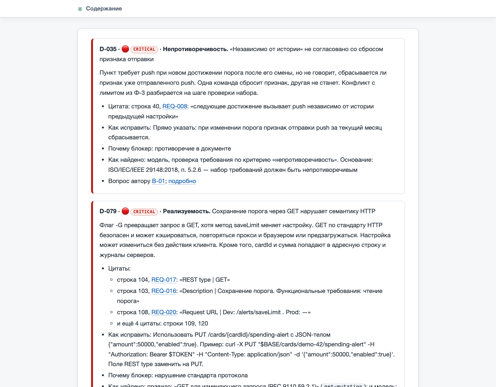

# Ревизор ТЗ

[](https://github.com/Artmaster5/revizor-tz/actions/workflows/tests.yml) — 1224 теста проходят на Windows, macOS и Linux, Python 3.10, 3.12 и 3.13

ИИ-агент проверяет документ с требованиями до начала разработки и пишет отчёт на русском языке. Главное в нём — уточнение: агент задаёт автору конкретные вопросы, принимает ответы, перепроверяет документ и показывает, что изменилось.

## Для жюри: где что

| Что | Где |
| :--- | :--- |
| Видео, 4 мин 44 с | [youtu.be/4_AOG0X5nH4](https://youtu.be/4_AOG0X5nH4) |
| Презентация | [`presentation.pdf`](presentation.pdf) |
| Отчёт агента по документу организаторов | [`reports/report.md`](reports/report.md), страница [`report.html`](reports/report.html) (светлая и тёмная тема — кнопкой), [`report.pdf`](reports/report.pdf), сводка на одну страницу [`report.summary.md`](reports/report.summary.md) |
| Вопросы автору и перепроверка с ответами | [`reports/report.questions.md`](reports/report.questions.md), письмо автору [`report.letter.md`](reports/report.letter.md), пример ответов [`docs/demo/answers.md`](docs/demo/answers.md) |
| Требования, переписанные агентом | [`reports/report.fixed.md`](reports/report.fixed.md) |
| Черновики приёмочных тестов и задачи для Jira | [`report.tests.md`](reports/report.tests.md), [`report.jira.csv`](reports/report.jira.csv) |
| Точность | все 10 дефектов организаторов; 49 из 52 и ещё 2 частично по нашему списку (независимый судья, Opus); 102 из 109 на 8 незнакомых документах, включая казахский и английский (Sonnet) — [подробно](#точность) |
| Бесплатно и локально | бесплатный Gemini: 2 мин 43 с, $0, все 10 дефектов организаторов; локальная Gemma 4 на MacBook (модель 6,4 ГБ, документ не покидает компьютер): 36 мин, $0, 9 из 10 полностью и место десятого — [`docs/runs/`](docs/runs/README.md) |
| Запустить за минуту, без ключа | [Запуск одной командой](#запуск-одной-командой); окно — `python main.py --ui`, кнопка «Попробовать на примере» |
| Сравнение двух версий ТЗ | `python main.py --compare старый.json новый.json`: что закрыто, что осталось, что нового. Пример — автор ответил на вопросы агента, вышла новая версия: закрыто 15 дефектов, блокеры 3 → 0, индекс готовности 54 → 82 (проверка правилами без модели) — [`docs/demo/compare/`](docs/demo/compare/v1_v3.compare.md), что изменено и по какому ответу — [`CHANGES.md`](docs/demo/compare/CHANGES.md) |
| Вызов из чата с ИИ (MCP) | агент подключается к Claude Desktop, Cursor и VS Code: аналитик пишет в чате «проверь это ТЗ» — [`docs/MCP.md`](docs/MCP.md) |
| Как устроен | [`docs/ARCHITECTURE.md`](docs/ARCHITECTURE.md) |
| Тесты агента | 1224 теста без ключей и без сети; на GitHub проходят на Windows, macOS и Linux — [запуски](https://github.com/Artmaster5/revizor-tz/actions/workflows/tests.yml) |
| Ценность для банка и пилот | [`docs/VALUE.md`](docs/VALUE.md), [`docs/PILOT.md`](docs/PILOT.md) |
| Трудные вопросы и ответы на них: секретные документы, ошибки ИИ, деньги, внедрение | [`docs/FAQ.md`](docs/FAQ.md) |
| Полная карта проекта: все функции, где каждая в коде, все числа с источником | [`docs/FOR_AI_REVIEW.md`](docs/FOR_AI_REVIEW.md), удобно и для проверки с помощью ИИ |
| Всё по четырём критериям | [`SUBMISSION.md`](SUBMISSION.md) |

**Агент сам переписывает требования.** К отчёту он прикладывает [`reports/report.fixed.md`](reports/report.fixed.md): таблицу «было → стало» с новой формулировкой требования и ссылкой на замечание. После ответов автора — [`reports/report_answered.fixed.md`](reports/report_answered.fixed.md): формулировки с учётом ответов и со ссылкой на ответ. Автору остаётся прочитать их и вставить в документ.

Он нужен системному и бизнес-аналитику банка, а также разработчику и тестировщику, которые получают этот документ. Агент находит противоречия, двусмысленности, пропущенные сценарии и непроверяемые места. Каждое замечание он подкрепляет дословной цитатой с номером строки. Затем он готовит анкету вопросов автору, письмо автору, черновики приёмочных тестов и вердикт: можно ли начинать работу.

Документ организаторов (4 страницы в PDF, около 1 000 слов) агент проверяет на модели по умолчанию (Sonnet) за 2 мин 47 с, цена прогона $1.27 ≈ 582 ₸. На первом экране отчёта — итог, блокеры и первые вопросы автору.

## Уточнение: вопросы автору и перепроверка

Агент не ограничивается списком дефектов. По каждому месту, где требование нельзя понять однозначно, он готовит вопрос автору:

- **Вопрос конкретный.** У него есть цитата из документа с номером строки, причина («почему спрашиваем»), варианты ответа «а), б), в)» и адресат: бизнес-заказчик, архитектор, безопасность или тестирование.
- **У вопроса есть последствие.** Строка «Что изменит ответ в итоге» показывает, сколько блокеров снимет ответ и как сдвинется индекс готовности, например «закроет 2 из 6 блокеров · индекс готовности 18 → 19». Это число считает программа.
- **У вопроса есть допущение.** Под каждым вопросом написано «Если автор не ответит, считаем так: …» или прямо сказано, что без ответа работу по пункту начинать нельзя.
- **Автор отвечает там, где ему удобно.** В окне (`python main.py --ui`) он выбирает вариант или пишет своими словами и нажимает «Перепроверить с ответами». В терминале — вписывает ответы в анкету `<отчёт>.questions.md` и запускает проверку с `--answers`, или отвечает по одному вопросу с `--interactive`.
- **Агент показывает «было → стало».** Окно пишет, сколько ответов учтено, какие замечания они закрывают, как изменились число блокеров, индекс готовности и вердикт. Блок «Кратчайший путь к „можно начинать“» называет вопросы, на которые нужно ответить, чтобы закрыть все блокеры.
- **Агент проверяет исправление.** Если для замечания есть готовая формулировка, правило, которое нашло дефект, запускается на ней ещё раз; если дефект остался, ответ не засчитывается. На карточке стоит «Проверка исправления: снято», «остаётся» или «не проверено кодом».
- **Агент говорит, что вписать в документ.** Блок «Что вписать в документ» показывает место (строку и цитату), ответ автора и готовую формулировку, прошедшую проверку, с кнопкой «Скопировать». Если формулировки нет, текст не выдумывается.
- **Письмо автору.** Рядом с отчётом лежит `<отчёт>.letter.md`: вопросы сгруппированы по адресатам. В окне есть кнопка «Скопировать письмо».
- **Ответ не попадёт не к тому вопросу.** В анкете у вопроса и у документа есть отпечатки. Если вопрос или документ изменились с тех пор, как выдана анкета, ответ на этот вопрос не применяется, а отчёт предупреждает об этом.

**Пример на сданном отчёте.** Анкета с ответами за автора — [`docs/demo/answers.md`](docs/demo/answers.md): 17 ответов из 20 учтены, часть буквой, часть своими словами. Результат — [`reports/report_answered.md`](reports/report_answered.md): закрыто 28 замечаний, в том числе 5 блокеров из 6; агент задал 13 новых уточняющих вопросов. Оставшийся блокер закрывается только заполнением раздела «Тестирование требований»: ответ о том, кто и когда его заполнит, блокер не закрывает. Первые этапы этого прогона взяты из кэша.

**Тот же круг без ключа и без денег:**

```bash
python main.py --input docs/requirements.md --output reports/my_answered.md --provider offline --answers reports/sample_answers.md
```

Подробно — в [`docs/USAGE.md`](docs/USAGE.md#диалог-с-автором-тз) и [`docs/INTEGRATION.md`](docs/INTEGRATION.md#петля-1-ответы-автора-на-вопросы).

## Вызов из чата с ИИ (MCP)

Агент подключается к Claude Desktop, Cursor и VS Code как MCP-сервер: аналитик пишет в чате «проверь это ТЗ», чат запускает проверку и пересказывает итог, а полный отчёт ложится в папку. Запуск: `python mcp_server.py`. Инструменты: `check_requirements` (проверка, можно быстрый режим `depth: fast`), `verify_quote` (есть ли цитата в документе, без модели), `list_checks` (что проверяет агент), `estimate_run` (цена и время до запуска). Настройка для каждого приложения и пример диалога — [`docs/MCP.md`](docs/MCP.md).

## Запуск одной командой

1. **Установите.** Нужен Python 3.10 или новее. Проверьте версию: `python3 --version`. Системный Python на macOS — 3.9, он не подойдёт: установка остановится на строке `No matching distribution found for anthropic>=2.0`. Тогда поставьте Python 3.10 или новее (с python.org или `brew install python`) и создайте окружение им, например `python3.12 -m venv .venv`. В папке репозитория:

   ```bash
   python3 -m venv .venv
   source .venv/bin/activate          # Windows: .venv\Scripts\activate
   pip install -r requirements.txt
   ```

2. **Запустите без ключа.** Это работает сразу: проверка правилами без модели, бесплатно, текст документа никуда не уходит.

   ```bash
   python main.py --input docs/requirements.md --output reports/my_report.md --provider offline
   ```

   Без ключа вы увидите отчёт по документу организаторов: 27 замечаний, из них 3 блокера, и 26 вопросов автору, а рядом анкету, черновики тестов и страницу `my_report.html`. Прогон занимает меньше секунды. Такой же отчёт сохранён в [`reports/report_offline.md`](reports/report_offline.md). Круг «вопросы → ответы автора → перепроверка» без ключа запускает команда из раздела «Уточнение» выше; окно `python main.py --ui` тоже работает без ключа. Полный отчёт с моделью запускать не обязательно: он сохранён в [`reports/report.md`](reports/report.md), страница — [`reports/report.html`](reports/report.html).

3. **Запустите с моделью.** Положите один ключ в `.env`:

   ```bash
   cp .env.example .env
   ```

   - бесплатно: Google Gemini, ключ на [aistudio.google.com](https://aistudio.google.com/) → `GEMINI_API_KEY=`;
   - Anthropic (Claude): ключ на console.anthropic.com → `ANTHROPIC_API_KEY=`;
   - OpenAI или совместимый сервер: `OPENAI_API_KEY=` и при своём сервере `OPENAI_BASE_URL=`;
   - локальная Ollama: `OLLAMA_BASE_URL=` и `OLLAMA_MODEL=`, ключ не нужен.

   Если в `.env` несколько ключей, первым берётся Anthropic. Другого провайдера выбирает `--provider gemini` или `LLM_PROVIDER=gemini`. Затем та же команда без `--provider offline`:

   ```bash
   python main.py --input docs/requirements.md --output reports/my_report.md
   ```

   Агент печатает ход работы по девяти этапам, у каждого — секунды; в конце итог, время и цена. Цену можно узнать заранее: `--estimate`.

4. **Или в окне браузера.** Одна команда открывает страницу:

   ```bash
   python main.py --ui
   ```

   На первом экране кнопка «Попробовать на примере» проверяет встроенный пример: без ключа сразу, бесплатно. Дальше выбирают свой документ, при желании прикладывают ответы автора, выбирают модель и глубину, заранее видят оценку цены и нажимают «Проверить». Ход показан по тем же девяти этапам, что в терминале, с секундами и числом ответов из кэша. В конце — вердикт, две строки готовности (для разработки и для тестирования), число замечаний, вопросы автору с ответами прямо в окне и кнопки «Открыть отчёт», «Анкета для автора», «Замечания для Jira (CSV)». Файлы пишутся в папку `reports/ui`.

   Свой ключ можно вставить прямо в окне: «Вставить свой ключ» → провайдер → ключ → «Применить», затем «Проверить». Ключ хранится только в памяти окна до его закрытия и никуда не записывается.

   Окно работает только на этом компьютере (адрес `127.0.0.1`). Проверку делает тот же код, что и в терминале, новых зависимостей нет, наружу уходят только те же запросы к модели. Остановить — `Ctrl+C`. Параметры окна — в [`docs/USAGE.md`](docs/USAGE.md#окно-в-браузере).


Отчёт лежит по пути из `--output`. Все параметры, переменные окружения и коды возврата — в [`docs/USAGE.md`](docs/USAGE.md).

## Что получает аналитик

Готовый результат по документу организаторов [`docs/requirements.md`](docs/requirements.md):

| Файл | Что внутри |
| :--- | :--- |
| [`reports/report.summary.md`](reports/report.summary.md) | одна страница: вердикт, 6 блокеров, первые вопросы автору |
| [`reports/report.md`](reports/report.md) | отчёт: первый экран, 8 разделов, приложение; каждое замечание один раз, в короткой форме |
| [`reports/report.details.md`](reports/report.details.md) | подробности: полные карточки с цитатами, разбор по каждому требованию, карта полноты, вопросы автору с вариантами |
| [`reports/report.html`](reports/report.html) | отчёт и подробности одной страницей для браузера, работает без интернета |
| [`reports/report.pdf`](reports/report.pdf) | та же страница в PDF, 104 страницы; напечатана из `report.html` в браузере, сам агент PDF не пишет |
| [`reports/report.questions.md`](reports/report.questions.md) | анкета для автора ТЗ: 21 вопрос с вариантами ответа |
| [`reports/report.tests.md`](reports/report.tests.md) | черновики приёмочных тестов «Дано / Когда / Тогда» |
| [`reports/report.fixed.md`](reports/report.fixed.md) | предложенные формулировки требований |
| [`reports/report.findings.csv`](reports/report.findings.csv) | замечания таблицей, по строке на замечание |
| [`reports/report.jira.csv`](reports/report.jira.csv) | те же замечания в столбцах для импорта в Jira |

Рядом с отчётом агент пишет до двенадцати файлов: с моделью двенадцать, без модели одиннадцать. Кроме перечисленных, это `.json` (то же в машинном виде), `.diagnostic.md` (что произошло в прогоне) и письмо автору `.letter.md`; `.fixed.md` появляется с моделью или после ответов автора. Образцы других режимов — в [`reports/README.md`](reports/README.md).

Итог сданного отчёта: 49 требований, 86 замечаний (6 блокеров, 26 существенных, 54 мелких), 21 вопрос автору, индекс готовности 18 из 100, вердикт «начинать нельзя». После ответов автора (17 из 20 учтены) закрыто 28 замечаний, блокеров остаётся 1 из 6: [`reports/report_answered.md`](reports/report_answered.md).

Что ещё в отчёте:

- **Вердикт считает программа, а не модель.** Есть открытый блокер — «начинать нельзя». Нет блокеров, есть существенные замечания — «после правок». Иначе — «можно». Уровень замечания предлагает модель, но блокером оно остаётся, только если названо одно из пяти оснований закрытого списка и отдельный проход перепроверки его подтвердил; блокер без основания программа понижает сама. Текстом ответа сменить вердикт модель не может.
- **Две строки готовности под вердиктом:** «можно отдавать в разработку» и «можно отдавать в тестирование» с долей требований, закрытых критериями приёмки.
- **Каждую цитату проверяет программа.** Она ищет цитату в тексте документа. Если фразы в документе нет, замечание выбрасывается, а счётчик отброшенных виден в паспорте прогона. В сданном отчёте подтверждено 286 цитат, отброшено 10.
- **Основание у каждого замечания.** Карточка называет пункт ISO/IEC/IEEE 29148:2018 (5.2.5, 5.2.6 или 5.2.7), на который опирается замечание.
- **Ничего найденное не прячется.** Замечание, объединённое с другим, печатается на карточке со своим текстом и цитатой; в файле подробностей есть часть «Что было снято и почему».
- **Паспорт прогона:** SHA-256 документа и файла ответов, версия набора правил, модель, время, цена.
- **Черновики приёмочных тестов.** Ожидаемый результат берётся только из документа. Если его там нет, тест помечен как ждущий ответа автора.
- **Выгрузка в CSV и Jira.** Замечания таблицей и в столбцах для импорта в Jira (Summary, Description, Priority, Labels, Issue Type).
- **Защита от подсаженных указаний и маскирование данных.** Текст документа для модели — только данные. Обращения к проверяющему или к ИИ внутри документа правило показывает как дефект. Номера карт, ИИН/БИН, адреса почты и телефоны заменяются звёздочками до отправки модели.




## Как устроен

Девять этапов; порядок, цитаты, номера, индексы и вердикт ведёт программа, модель даёт смысловые замечания, вопросы и формулировки.

1. Чтение документа (md, txt, pdf, docx, html) и маскирование личных данных — программа.
2. Нарезка на требования; номера `REQ-…` выдаёт программа.
3. 82 основных правила и 8 наблюдений без модели: работают всегда, в том числе без ключа.
4. Проверка каждого требования тремя линзами — модель.
5. Проверка набора целиком и критик с 35 контрольными вопросами — модель.
6. Сверка цитат с текстом документа и слияние повторов — программа.
7. Перепроверка скептиком — модель.
8. Вопросы автору, допущения, письмо, проверка исправления.
9. Индексы, вердикт, две готовности — считает программа; затем отчёт и файлы рядом.

Схема со всеми этапами, гарантиями и режимами — в [`docs/ARCHITECTURE.md`](docs/ARCHITECTURE.md).

**Три режима**

| Режим | Как включить | Что делает |
| :--- | :--- | :--- |
| Обычный | по умолчанию; модель `claude-sonnet-5-5` (Sonnet); дешевле — `--model claude-haiku-5-5` (Haiku) или бесплатная `gemini-flash-latest` | все этапы с моделью |
| Глубокий | `--model claude-opus-5-5` (Opus — максимум) | то же на самой сильной модели; сначала посмотрите цену через `--estimate` |
| Без модели | `--provider offline` | только правила: 0,3 с, $0, текст никуда не уходит; вердикт помечен предварительным |

Сданный отчёт `reports/report.md` сделан в глубоком режиме на модели `claude-opus-5-5`, версия 1.5.0. Его написал сам агент командой `python main.py --input docs/requirements.md --output reports/report.md --model claude-opus-5-5`; повторная проверка с ответами автора — та же команда с `--output reports/report_answered.md --answers docs/demo/answers.md`. Тот же документ на модели `claude-haiku-5-5` — [`reports/report_haiku.md`](reports/report_haiku.md). История тегов и перерисованных отчётов — в [`docs/HISTORY.md`](docs/HISTORY.md). Отчёт на модели Haiku в `reports/` собран на прежней версии (тег `v1.1.1`); числа раздела «Точность» ниже измерены на версии 1.4.0 отдельными прогонами.

**Тесты.** 1224 теста, без ключей и без сети; на GitHub они проходят на Windows, macOS и Linux, Python 3.10, 3.12 и 3.13 ([запуски](https://github.com/Artmaster5/revizor-tz/actions/workflows/tests.yml)):

```bash
python -m unittest discover -s tests -t .
```

Примеры проверки в CI: [`docs/ci-example.yml`](docs/ci-example.yml) (GitHub Actions) и [`docs/ci-gitlab-example.yml`](docs/ci-gitlab-example.yml) (GitLab).

## Точность

Рядом всегда три числа. «Строго» и «по месту» считает программа: строго — совпали и место в документе, и суть замечания; по месту — только место. Третье число ставит судья: независимая ИИ-модель в отдельной сессии, которая не видела ни наших оценок, ни переписки; судья один и тот же для всех моделей. Везде названа модель: Opus — максимум, Sonnet — по умолчанию, Haiku — дешевле. Всё измерено на версии 1.4.0 (код замера — коммит `2a2060a`; правки от него до тега `v1.4.0` меняют окно, документы и число вопросов, список замечаний не меняют), кроме строк и столбцов, где версия названа отдельно. В версии 1.5.0 добавлено 35 правил без модели; их вклад показывает строка «Без модели». Сдаваемый отчёт версии 1.5.0 на Opus судья оценил отдельно — первый столбец таблицы; остальные числа с моделью измерены на версии 1.4.0.

**Документ организаторов.** В нашем списке 52 дефекта, десять из них назвали сами организаторы.

| | Opus (максимум), 1.5.0 — сдаваемый отчёт | Opus (максимум), 1.4.0 | Sonnet (по умолчанию), 1.4.0 | Было в версии 1.2.0, Opus |
| :--- | :--- | :--- | :--- | :--- |
| Пункты организаторов, программа | 9 строго, 10 по месту | 10 из 10 | 10 из 10 | 10 из 10 |
| Пункты организаторов, судья | **10 из 10** | 9 и 1 частично | 10 из 10 | 8 и 2 частично |
| Наш список из 52, судья | **49, ещё 2 частично** | 50, ещё 2 частично, пропусков нет | 47, ещё 2 частично | 47, ещё 5 частично |
| Наш список, программа: строго / по месту | 43 / 50 из 52 | 45 / 50 из 52 | 44 / 50 из 52 | 40 / 50 из 52 |
| Блокеры ключа найдены | 5 из 5, все с уровнем «блокер» | 5 из 5, все с уровнем «блокер» | 5 из 5 | 3 из 5 строго |
| Замечаний по делу, судья | 84 из 86 | 86 из 86 | 86 из 87 | 66 из 66 |
| Время полной проверки | отдельно не измерено | отдельно не измерено | **2 мин 47 с** | 7 мин 54 с |
| Цена полной проверки | отдельно не измерена | отдельно не измерена | **$1.27 ≈ 582 ₸** | $3.23 |

«Было» по судье — это версия 1.2.0, оценённая тем же судьёй, что и версия 1.4.0. Сдаваемый отчёт версии 1.5.0 оценил судья с тем же заданием, файлы — `eval/results/v150_opus/`. Без модели, только правила (бесплатно, 0,3 с), версия 1.5.0: 27 замечаний, 9 из 10 пунктов организаторов строго и 10 из 10 по месту, 19 из 52 строго и 32 из 52 по месту; в версии 1.2.0 было 7 из 10 и 14 из 52, правил стало 82 (было 27).

Правила и подсказки модели написаны общими словами, без привязки к документу. Документ организаторов использовался при настройке, поэтому независимую оценку даёт замер на новых документах ниже.

**Документы, которых агент не видел.** Двенадцать документов в трёх наборах по четыре; их и ключи к ним написали отдельные ИИ-помощники, не видевшие агента. Ключи заморожены до запуска. Сверка программой, строго:

| Набор | Sonnet (по умолчанию) | Haiku (дешевле) | Было, версия 1.2.0, Haiku |
| :--- | :--- | :--- | :--- |
| 4 документа, 55 дефектов | 52 | 54 | — |
| 4 документа, 56 дефектов | — | 51 | 42 |
| 4 документа, с казахским и английским, 54 дефекта | 50 | 50 | 44 |
| **Всего** | **102 из 109 (94 %)** на 8 документах | **155 из 165 (94 %)** на 12 документах | 86 из 110 на 8 документах |

Sonnet проверяет такой документ за 168–208 секунд, цена — от $1.26 до $1.53 за документ.

Что из этого следует:

- **Все десять дефектов, названных организаторами, агент находит** (судья: 10 из 10 в сдаваемом отчёте Opus и на Sonnet).
- **Opus находит почти весь наш список:** в сдаваемом отчёте версии 1.5.0 судья засчитал 49 дефектов из 52 и ещё 2 частично; замечаний по делу 84 из 86. На версии 1.4.0 — 50 и ещё 2 частично.
- **Блокеры ключа найдены все:** 5 из 5 на Sonnet и на Opus.
- **На незнакомых документах, включая казахский и английский,** Sonnet нашёл 102 дефекта из 109, а Haiku — 155 из 165.
- **До и после** (Opus, по судье, версия 1.2.0 → 1.4.0): 47 и 5 частично → 50 и 2 частично, пропусков нет; строго по программе 40 → 45 из 52; блокеры ключа строго 3 → 5 из 5; замечаний по делу 66 из 66 → 86 из 86.

Метод, все таблицы и изменение ключа — в [`eval/ACCURACY.md`](eval/ACCURACY.md).

## Ценность для банка

Цена и время одного прогона на документе организаторов. Цена и время Sonnet — замер на версии 1.4.0; остальное в таблице — расчёт калькулятора при параметрах по умолчанию, а строки с названной версией — прежние замеры.

| Режим | Цена прогона | Это время аналитика | Машинное время | Порог окупаемости |
| :--- | :--- | :--- | :--- | :--- |
| Sonnet (по умолчанию) | $1.27 ≈ 582 ₸ | 17 мин | 2 мин 47 с | 37 мин на документ, 61 % ручной проверки |
| Haiku (дешевле), прежняя версия, тег v1.1.1 | $0.18 ≈ 85 ₸ | 2,4 мин | 10 мин 13 с | 22 мин на документ, 37 % ручной проверки |
| Opus (максимум), версия 1.2.0 | $3.23 ≈ 1 479 ₸ | 43 мин | 7 мин 54 с | 1 ч 3 мин на документ, 105 % ручной проверки |
| Бесплатный Gemini, прежняя версия, тег v1.1.1 | 0 | 0 | 7 мин 17 с | 20 мин на документ, 33 % ручной проверки |
| Без модели | 0 | 0 | 0,3 с | 20 мин на документ, 33 % ручной проверки |

Порог окупаемости — сколько времени проверяющих агент должен сэкономить на одном документе, чтобы окупить прогон и 20 минут на чтение отчёта. Параметры по умолчанию: три проверяющих, 15 страниц в час, час аналитика 2 075 ₸. При них ручная проверка этого документа занимает 1 человеко-час. Для Sonnet: $1.27 × 458,28 ₸ = 582 ₸, это 17 мин аналитика, плюс 20 мин на чтение = 37 мин, то есть 61 % ручной проверки.

20 минут на чтение — допущение, а не замер: столько занимают сводка и первый экран отчёта. Какую долю ручной работы агент убирает на самом деле, не измерено: это задача пилота. Глубокий режим (Opus) имеет смысл на большом или дорогом по последствиям документе, где нужен максимум полноты.

Калькулятор окупаемости и его параметры — в [`docs/VALUE.md`](docs/VALUE.md#калькулятор-окупаемости). Где агент встаёт в процесс банка — в [`docs/INTEGRATION.md`](docs/INTEGRATION.md#коротко-четыре-места).

**Пилот на две недели** ([`docs/PILOT.md`](docs/PILOT.md)). Неделя 1: агент проверяет 10–12 прошлых документов, аналитики сверяют его замечания с ревью людей и с дефектами, найденными потом в разработке. Неделя 2: 4–6 новых документов идут через ревью по очереди, с агентом и без, и проверяющие ведут учёт часов. Предлагаемые пороги успеха: совпадение с ревью людей не меньше 40 %, доля лишних замечаний не больше 30 %, экономия не меньше порога окупаемости. Пороги утверждает банк.

**Линза соответствия.** При проверке с моделью критик отвечает на пять вопросов о данных клиентов и карт (PD1–PD5): цели и согласие, где хранятся данные и уходят ли они за границу, не хранятся ли CVV и PIN, не показывается ли номер карты целиком и не попадает ли он в журналы, ведётся ли журнал доступа. Опора — Закон РК № 94-V «О персональных данных и их защите» и PCI DSS v4.0.1. Это список вопросов для безопасности и комплаенса, а не юридическое заключение.

## Соответствие заданию

| Что требует задание | Где это в решении |
| :--- | :--- |
| Один документ на входе, путь аргументом | `--input путь` или первым аргументом без ключа; `revizor/cli.py` |
| PDF и другие форматы | `.md`, `.txt`, `.pdf`, `.docx`, `.html`; `revizor/loader.py` |
| Битый или пустой файл — диагностика, а не падение | отчёт «Документ не проверен» с причиной и шагами; испорченные файлы — `examples/broken/`, их отчёты — `reports/diagnostics/` |
| Нарезка на требования, свои номера там, где их нет | раздел 2 отчёта: номер `REQ-…` от программы, номер из документа рядом, формулировка — цитата со строкой |
| Таблица «ID в отчёте — ID в документе — формулировка» | раздел 2 отчёта |
| Проверка каждого требования по критериям | раздел 3: матрица «требование × критерий», семь критериев, замечания с местом, цитатой и правкой; разбор по каждому требованию — в `<отчёт>.details.md` |
| Проверка набора целиком | раздел 4, подразделы 4.1–4.5, и «Карта полноты» — итог по 35 контрольным вопросам (ответы на каждый — в `<отчёт>.details.md`) |
| Критерии ISO/IEC/IEEE 29148 | у каждого замечания названы критерий и пункт стандарта (строка «Основание»); таблица «Замечания по критериям качества» — в разделе 5 |
| Каждое замечание привязано к месту документа | у каждого замечания номер строки и ссылка на требование, у блокеров и существенных — ещё и цитата; все цитаты — в `<отчёт>.details.md`; цитату ищет `revizor/quotes.py` |
| Сводка: требования, нарушения, список критичных | первый экран и раздел 5 |
| Итог: можно ли начинать, что исправить первым | раздел 6 |
| Уточняющие вопросы автору | раздел 7, анкета `<отчёт>.questions.md`, письмо `<отчёт>.letter.md` и вопросы в окне |
| Паспорт прогона: документ, дата, модель, версия агента | раздел 1: документ и его SHA-256, дата, модель, тег и коммит агента, версия набора правил |
| Отчёт на русском в файл | путь из `--output`; рядом JSON и другие файлы |
| Запуск одной командой | `python main.py --input docs/requirements.md --output reports/my_report.md` |
| Любая LLM, в том числе бесплатная | `--provider`: `anthropic`, `gemini`, `openai`, `ollama`, `offline`; `revizor/llm/` |
| `.env.example` без ключей, секреты не в репозитории | в `.env.example` только заглушки; `.env` в `.gitignore`; ключ вырезается из текстов ошибок |
| README: ключ, запуск, куда ляжет отчёт | «Запуск одной командой» |

## Документы и структура

- [`SUBMISSION.md`](SUBMISSION.md) — страница сдачи: что смотреть первым и где показан каждый критерий
- [`docs/USAGE.md`](docs/USAGE.md) — все параметры, файлы рядом с отчётом, уровни, индексы, коды возврата, переменные окружения
- [`docs/ARCHITECTURE.md`](docs/ARCHITECTURE.md) — схема этапов, гарантии, модули, сбои и запасные пути, решения
- [`docs/VALUE.md`](docs/VALUE.md) — ценность для банка: расчёт, источники, линза соответствия
- [`docs/PILOT.md`](docs/PILOT.md) — план пилота на две недели
- [`docs/INTEGRATION.md`](docs/INTEGRATION.md) — встраивание в процесс: CI, Jira, Confluence
- [`eval/ACCURACY.md`](eval/ACCURACY.md) — как измерялась точность
- [`docs/slides/`](docs/slides/README.md) — исходник слайдов и как их пересобрать; готовые слайды — [`presentation.pdf`](presentation.pdf)
- [`docs/HISTORY.md`](docs/HISTORY.md) — история тегов и перерисованных отчётов

Карта папок — в [`docs/USAGE.md`](docs/USAGE.md#структура-проекта).

## Лицензия и автор

MIT, см. [`LICENSE`](LICENSE). Автор — Artur Yegizbayev.
