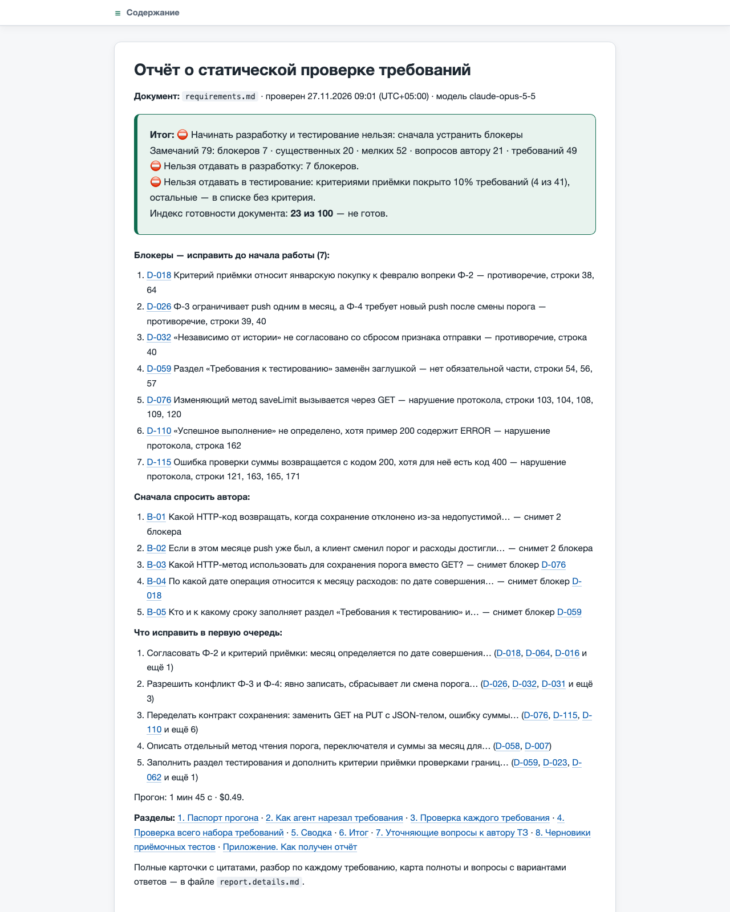
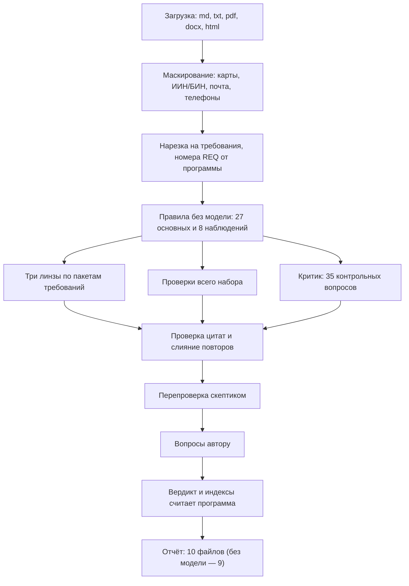

# Ревизор ТЗ

ИИ-агент, который проверяет документ с требованиями до начала разработки и пишет отчёт на русском языке.

Он нужен системному и бизнес-аналитику банка, а также разработчику и тестировщику, которые получают этот документ. Агент находит противоречия, двусмысленности, пропущенные сценарии и непроверяемые места. Каждое замечание он подкрепляет дословной цитатой с номером строки. Затем он готовит анкету вопросов автору, черновики приёмочных тестов и вердикт: можно ли начинать работу.

Документ организаторов (4 страницы в PDF, около 1 000 слов) агент проверяет за 7–10 минут. На первом экране отчёта — итог, блокеры и первые вопросы автору.

## Посмотреть за минуту

Готовый результат по документу организаторов [`docs/requirements.md`](docs/requirements.md):

| Файл | Что внутри |
| :--- | :--- |
| [`reports/report.summary.md`](reports/report.summary.md) | одна страница: вердикт, 5 блокеров, первые вопросы автору |
| [`reports/report.md`](reports/report.md) | полный отчёт: первый экран, 8 разделов, приложение |
| [`reports/report.html`](reports/report.html) | тот же отчёт одним файлом для браузера, работает без интернета |
| [`reports/report.questions.md`](reports/report.questions.md) | анкета для автора ТЗ: 20 вопросов с вариантами ответа |
| [`reports/report.tests.md`](reports/report.tests.md) | черновики приёмочных тестов «Дано / Когда / Тогда» |
| [`reports/report.fixed.md`](reports/report.fixed.md) | предложенные формулировки требований |
| [`reports/report.findings.csv`](reports/report.findings.csv) | замечания таблицей, по строке на замечание |
| [`reports/report.jira.csv`](reports/report.jira.csv) | те же замечания в столбцах для импорта в Jira |




Слайды: [`presentation.pdf`](presentation.pdf). Демо-видео: ссылка в форме сдачи.

Итог сданного отчёта: 51 требование, 66 замечаний (5 блокеров, 20 существенных, 41 мелкое), 20 вопросов автору, вердикт «начинать нельзя».

## Что получает аналитик

- **Вердикт считает программа, а не модель.** Есть открытый блокер — «начинать нельзя». Нет блокеров, есть существенные замечания — «после правок». Иначе — «можно». Модель не может уговорить программу сменить вердикт.
- **Каждую цитату проверяет программа.** Она ищет цитату в тексте документа. Если фразы в документе нет, замечание выбрасывается, а счётчик отброшенных виден в паспорте прогона. В сданном отчёте подтверждено 274 цитаты, отброшено 7.
- **Анкета автору и повторная проверка.** Вопросы с вариантами ответа и с подсчётом, что изменит ответ: сколько блокеров он закроет и как сдвинется индекс готовности. Автор отвечает, агент пересчитывает отчёт.
- **Черновики приёмочных тестов.** Ожидаемый результат берётся только из документа. Если его там нет, тест помечен как ждущий ответа автора.
- **Выгрузка в CSV и Jira.** Замечания таблицей и в столбцах для импорта в Jira (Summary, Description, Priority, Labels, Issue Type).
- **HTML-отчёт.** Один файл, открывается без интернета, печатается в PDF.
- **Защита от подсаженных указаний и маскирование данных.** Текст документа для модели — только данные. Обращения к проверяющему или к ИИ внутри документа правило показывает как дефект. Номера карт, ИИН/БИН, адреса почты и телефоны заменяются звёздочками до отправки модели.

## Быстрый старт

1. **Установите.** Нужен Python 3.10 или новее (живьём агент запускался только на 3.15). В папке репозитория:

   ```bash
   python3 -m venv .venv
   source .venv/bin/activate          # Windows: .venv\Scripts\activate
   pip install -r requirements.txt
   ```

2. **Положите ключ модели в `.env`.**

   ```bash
   cp .env.example .env
   ```

   Откройте `.env` и впишите один ключ:

   - бесплатно: Google Gemini, ключ на [aistudio.google.com](https://aistudio.google.com/) → `GEMINI_API_KEY=`;
   - Anthropic (Claude): ключ на console.anthropic.com → `ANTHROPIC_API_KEY=`;
   - OpenAI или совместимый сервер: `OPENAI_API_KEY=` и при своём сервере `OPENAI_BASE_URL=`;
   - локальная Ollama: `OLLAMA_BASE_URL=` и `OLLAMA_MODEL=`, ключ не нужен.

   Без ключа агент тоже работает: только правилами, без модели. Если в `.env` несколько ключей, первым берётся Anthropic. Другого провайдера выбирает `--provider gemini` или `LLM_PROVIDER=gemini`.

3. **Запустите одной командой.**

   ```bash
   python main.py --input docs/requirements.md --output reports/my_report.md
   ```

   Агент печатает ход работы по этапам, в конце — итог, время и цену.

4. **Откройте отчёт.** Он лежит по пути из `--output`: `reports/my_report.md`. Рядом — файлы с тем же именем: `.summary.md`, `.html`, `.questions.md`, `.tests.md`, `.csv` и другие. Полный список — в [`docs/USAGE.md`](docs/USAGE.md).

**Три режима.**

| Режим | Как включить | Что делает |
| :--- | :--- | :--- |
| Обычный | по умолчанию; модель `claude-haiku-5-5` или бесплатная `gemini-flash-latest` | все этапы с моделью |
| Глубокий | `--model claude-opus-5-5` | то же на самой сильной модели; дороже, сначала посмотрите цену через `--estimate` |
| Без модели | `--provider offline` | только правила: 0,1 с, $0, текст никуда не уходит; вердикт помечен предварительным |

Сданный отчёт `reports/report.md` сделан в глубоком режиме: `--model claude-opus-5-5 --no-cache`, тег `v1.1.1`. Тот же документ на модели по умолчанию — [`reports/report_haiku.md`](reports/report_haiku.md). Точность и цена обоих режимов — в разделах «Точность» и «Ценность для банка».

В паспорте отчётов стоит «v1.0.0 (тег `v1.1.1`)». Первое — строка версии пакета, её не поднимали. Точная версия кода — тег и коммит. После тега `v1.1.1` код агента не менялся: `git diff v1.1.1 HEAD --stat -- revizor main.py tests tools` ничего не покажет. Менялись документы, шаблон слайдов и результаты замеров, добавлен скрипт разбора результатов `eval/noise_by_stage.py`.

Все параметры, переменные окружения и коды возврата — в [`docs/USAGE.md`](docs/USAGE.md).

## Диалог с автором ТЗ

Рядом с отчётом агент пишет анкету `<отчёт>.questions.md`. В ней вопросы по группам: блокирующие, важные, желательные. У каждого вопроса — цитата из документа, варианты ответа «а), б), в)», кому адресован и строка «Что изменит ответ в итоге», например «закроет 1 из 5 блокеров · индекс готовности 23 → 32». Это число считает программа: убирает связанные замечания и заново считает вердикт и индекс.

Автор вписывает ответы буквой варианта или своими словами и запускает проверку с анкетой:

```bash
python main.py --input docs/requirements.md --output reports/my_report_answered.md --answers reports/my_report.questions.md
```

Что меняется после ответов:

- **С моделью** агент разбирает каждый ответ, отмечает закрытые замечания и показывает два вердикта: по документу как есть и после внесения ответов. Новые формулировки требований ложатся в `<отчёт>.fixed.md`. Первый проход берётся из кэша, к модели идёт в основном разбор ответов.
- **Без модели** выбранный вариант закрывает замечание, если вопрос составлен по шаблону этого замечания. Ответ своими словами записывается, а замечание остаётся открытым.
- В начале отчёта появляется строка: сколько ответов учтено и сколько замечаний закрыто.

**Пример на сданном отчёте.** Анкета с ответами за автора — [`docs/demo/answers.md`](docs/demo/answers.md): 16 ответов из 20, часть буквой, часть своими словами. Результат — [`reports/report_answered.md`](reports/report_answered.md): закрыто 16 замечаний, в том числе 4 блокера из 5, агент задал 11 новых уточняющих вопросов. Пятый блокер остался: раздел «Тестирование требований» в документе пуст, и ответ «заполним до начала разработки» его не закрывает. Поэтому вердикт после ответов прежний — «начинать нельзя». Этот прогон занял 2 минуты и стоил $0.40: первые этапы взяты из кэша.

Пример без модели: анкета [`reports/sample_answers.md`](reports/sample_answers.md), результат [`reports/report_offline_answered.md`](reports/report_offline_answered.md).

Вопросы можно задать и в терминале, по одному, до 7 штук, сначала блокирующие:

```bash
python main.py --input docs/requirements.md --output reports/my_report.md --interactive
```

Когда автор исправил сам документ, повторная проверка сравнивает новую версию (здесь `docs/requirements_v2.md` — файл, который пишет автор) с прошлым JSON-отчётом:

```bash
python main.py --input docs/requirements_v2.md --output reports/my_report_v2.md --baseline reports/my_report.json
```

В отчёте появится строка «С прошлой проверки»: сколько замечаний исправлено, сколько осталось, сколько новых.

## Точность

Рядом всегда три числа. «Строго» и «по месту» считает программа: строго — совпали и место в документе, и суть замечания; по месту — только место. Третье число ставит судья: ИИ-модель в отдельной сессии, которая не видела ни наших оценок, ни переписки. Запускали её мы сами, человек её вердикты не перепроверял. Всё измерено на теге `v1.1.1`, один прогон на число. Исключение — строка «до» в конце раздела: она измерена на теге `v1.0.0`.

**Документ организаторов.** В ключе 52 дефекта, десять из них назвали сами организаторы.

| Режим | Строго | По месту | Пункты организаторов, строго | Судья: найдено / частично / нет | Ложных по судье | Цена | Время |
| :--- | :--- | :--- | :--- | :--- | :--- | :--- | :--- |
| Глубокий, Opus — сданный отчёт | 40 из 52 | 50 из 52 | 10 из 10 (судья: 8 и 2 частично) | 41 / 7 / 4 | 1 из 66 замечаний | $3.23 | 7 мин 54 с |
| Обычный, Haiku | 37 из 52 | 51 из 52 | 8 из 10 (судья: 8 из 10) | 41 / 5 / 6 | 3 из 90 замечаний | $0.18 | 10 мин 13 с |
| Бесплатный Gemini | 22 из 52 | 44 из 52 | 9 из 10 | не судили | не судили | $0 | 7 мин 17 с |
| Без модели | 14 из 52 | 25 из 52 | 7 из 10 | не судили | не судили | $0 | 0,1 с |

На этом документе агента отлаживали, поэтому это не слепая проверка. Подсказки модели писались, когда образец отчёта организаторов уже был у нас. В памятке для финансовых систем (`revizor/prompts.py`, 15 пунктов) и в 35 контрольных вопросах критика (`revizor/gapcheck.py`) есть шаг суммы, несколько однотипных объектов у одного клиента и изменения задним числом — то же, что в этом образце. Пункты написаны общими словами, без привязки к документу. Но результат на документе организаторов не показывает, что агент найдёт в незнакомом тексте. Это показывает замер на четырёх новых документах ниже.

Пункты организаторов программа засчитывает по месту в документе и ключевым словам. Судья строже. В отчёте Opus он засчитал 8 пунктов полностью и 2 частично: отдельного замечания о нескольких картах одного клиента в отчёте нет, а возврат покупки за прошлый месяц назван только как случай, для которого нет приёмочной проверки. В отчёте Haiku судья не нашёл два пункта: шаг порога и возврат за прошлый месяц.

**Четыре новых документа,** которых агент не видел. Их и ключи к ним написал отдельный ИИ-помощник. Ключи заморожены до запуска, после замера код не менялся. В ключах 55 дефектов, из них 9 блокеров.

| Модель | Строго | По месту | Судья: найдено / частично / нет | Настоящих замечаний по судье | Ложных | Блокеров в отчётах | Цена |
| :--- | :--- | :--- | :--- | :--- | :--- | :--- | :--- |
| Haiku | 40 из 55 | 54 из 55 | 49 / 4 / 2 | 197 из 323 (61 %) | 77 | 18 | $0.84 |
| Opus | 41 из 55 | 53 из 55 | 50 / 3 / 2 | 185 из 291 (64 %) | 50 | 21 | $14.13 |

Что из этого следует:

- **По оценке судьи агент находит почти всё, что есть в ключе:** на незнакомых документах 49–50 дефектов из 55. Строго по программе — 40–41 из 55.
- **Агент шумит.** На новых документах ложное каждое четвёртое замечание у Haiku и каждое шестое у Opus, ещё 15–19 % — повторы. На документе организаторов ложное одно из 66: настолько агент подстроен под документ, на котором его отлаживали.
- **Агент завышает уровни.** Он поставил «блокер» 18 и 21 раз, а в ключах блокеров 9.
- **Opus находит столько же, сколько Haiku** (50 и 49 из 55 по судье). **Шумит он меньше** (ложных 17 % против 24 %) и стоит в 17 раз дороже. Это один прогон на четырёх документах.
- **До и после.** После доработок (версия `v1.0.0` → `v1.1.1`) строгий счёт на документе организаторов вырос с 32 до 40 из 52 (Opus, замороженный ключ). Плата: замечаний стало в полтора раза больше (66 вместо 45), а строгий счёт по блокерам упал с 4 из 4 до 2 из 4. Оба блокера агент назвал, но другими словами, чем ждёт ключ; ключ мы под ответы не правили.

Метод, все таблицы, изменение ключа, сбой на двух документах и оговорки — в [`eval/ACCURACY.md`](eval/ACCURACY.md).

## Как устроен



Три линзы, проверки набора и критик идут параллельно; в режиме экономии — по одному запросу. Линзы смотрят на требования пакетами: ясность; полнота и проверяемость; корректность. Проверки набора ищут противоречия между разделами, пропуски и нарушения стандартов. Критик обязан ответить на каждый из 35 закреплённых вопросов: «описано», «пробел» или «не относится». Так типовой пробел не пропускается молча. Подробно — в [`docs/ARCHITECTURE.md`](docs/ARCHITECTURE.md).

### Почему так и от чего отказались

| Решение | От чего отказались и почему |
| :--- | :--- |
| Вердикт, индексы и все числа в отчёте считает программа | Вердикт от модели. Модель может ошибиться в счёте, а текст документа может подсказать ей нужный ответ |
| Цитату проверяет программа; замечание без найденной цитаты выбрасывается | Доверять цитате модели. Модели выдумывают, а читатель должен открыть строку и убедиться |
| Три узкие линзы, проходы по набору, критик и скептик | Один большой запрос. Одному запросу трудно держать семь критериев; скептик убирает часть ложных тревог, но находку правила отклонить не может |
| Каждый ответ модели проверяется по схеме; при ошибке — один запрос на исправление. Сколько шагов не ответило, сказано на первом экране отчёта, какие именно — в `<отчёт>.diagnostic.md` | Молча терять шаг. Читатель должен знать, что не проверено |
| Кэш ответов модели на диске (`.cache/llm/`) | Платить заново за тот же документ. Повторный прогон и прогон с ответами автора берут готовое |
| Оценка цены до запуска (`--estimate`) и потолок расхода (`--max-cost`) | Узнавать цену после прогона. После потолка модель не вызывается, остальное делают правила |
| Режим экономии для бесплатных уровней (`LLM_ECONOMY`, для Gemini включён сам) | Слать все запросы сразу. Бесплатный уровень считает запросы и часто отвечает «перегружен» |
| Без фреймворков для агентов: стандартная библиотека Python, официальный пакет `anthropic` для Claude и `pypdf` для PDF | Готовый фреймворк. Лишние зависимости, а порядок шагов и проверки всё равно пришлось бы писать самим |

**Режим экономии.** Запросы идут по одному, по ценности: противоречия в наборе, критик, линзы, полнота, стандарты. Нарезка на требования идёт без модели. Шаг, сорвавшийся из-за перегрузки или тайм-аута, повторяется один раз во втором круге. Ждать перегруженный Gemini агент может до 600 с за прогон. На документе организаторов это 15 шагов модели.

Замер на бесплатном Gemini (тег v1.1.1, первый прогон без кэша): 15 шагов модели, ответ на 14, 47 запросов, 437 с, $0. У основной модели кончилась дневная квота (ответ 429), работу сделала запасная `gemini-flash-lite-latest`. Google много раз отвечал «перегружен» (503). Три шага не получили ответа в первом круге, все три ответили во втором. Единственный шаг без ответа (чек-лист ревью из самого документа) назван в отчёте. Второй прогон с кэшем доделал его за 4 с и 2 запроса.

**Тесты.** 700 тестов, без ключей и без сети:

```bash
python -m unittest discover -s tests -t .
```

Примеры проверки в CI: [`docs/ci-example.yml`](docs/ci-example.yml) (GitHub Actions) и [`docs/ci-gitlab-example.yml`](docs/ci-gitlab-example.yml) (GitLab).

## Ценность для банка

Цена и время одного прогона на документе организаторов. Это замер, остальное в таблице — расчёт калькулятора при параметрах по умолчанию.

| Режим | Цена прогона | Это время аналитика | Машинное время | Порог окупаемости |
| :--- | :--- | :--- | :--- | :--- |
| Обычный, Haiku | $0.18 ≈ 85 ₸ | 2,4 мин | 10 мин 13 с | 22 мин на документ, 37 % ручной проверки |
| Глубокий, Opus | $3.23 ≈ 1 479 ₸ | 43 мин | 7 мин 54 с | 1 ч 3 мин на документ, 105 % ручной проверки |
| Бесплатный Gemini | 0 | 0 | 7 мин 17 с | 20 мин на документ, 33 % ручной проверки |
| Без модели | 0 | 0 | 0,1 с | 20 мин на документ, 33 % ручной проверки |

Порог окупаемости — сколько времени проверяющих агент должен сэкономить на одном документе, чтобы окупить прогон и 20 минут на чтение отчёта. Параметры по умолчанию: три проверяющих, 15 страниц в час, час аналитика 2 075 ₸. При них ручная проверка этого документа занимает 1 человеко-час.

20 минут на чтение — допущение, а не замер. Столько занимают сводка и первый экран отчёта. Полный отчёт Opus по этому документу — 17 тысяч слов, читать его целиком больше часа. Если заложить 70 минут чтения, порог для Haiku — 1 ч 12 мин, это 121 % ручной проверки. Тот, кто читает отчёт целиком, времени не экономит ни в одном режиме.

Вывод из таблицы: **глубокий режим на таком коротком документе не окупается.** Его порог выше всей ручной проверки. Обычный режим окупается, если убирает больше трети ручной работы. Глубокий режим имеет смысл на большом или дорогом по последствиям документе, где важен отчёт с меньшим шумом. Какую долю ручной работы агент убирает на самом деле, не измерено: это задача пилота.

**Окупаемость.** Калькулятор берёт цену и время прогона из JSON-отчёта:

```bash
python tools/roi.py --report reports/report.json
```

Он печатает порог окупаемости: сколько минут проверяющих агент должен сэкономить на одном документе, чтобы окупить прогон и чтение отчёта. Ставка аналитика, темп ручной проверки, число проверяющих и размер документа — параметры, а не факты. У каждого числа калькулятор печатает источник или пометку «допущение», и любое можно заменить своим (`--hourly-rate-kzt`, `--pace`, `--reviewers`, `--pages-per-doc`). Экономия здесь рассчитана, а не измерена на живом аналитике.

**Где агент встаёт в процесс банка** ([`docs/INTEGRATION.md`](docs/INTEGRATION.md)):

1. Самопроверка аналитика до отправки документа на ревью.
2. Ворота в CI: `--fail-on critical` роняет проверку, если в документе есть блокер; нечитаемый документ с этим флагом даёт код 4 (без флага — код 0).
3. Замечания в Jira из `<отчёт>.jira.csv`.
4. Отчёт в Confluence: краткая сводка в начало страницы, полный отчёт во вложение.

Все четыре места работают и без модели: бесплатно, текст документа никуда не уходит.

**Пилот на две недели** ([`docs/PILOT.md`](docs/PILOT.md)). Неделя 1: агент проверяет 10–12 прошлых документов, аналитики сверяют его замечания с ревью людей и с дефектами, найденными потом в разработке. Неделя 2: 4–6 новых документов идут через ревью по очереди, с агентом и без, и проверяющие ведут учёт часов. Предлагаемые пороги успеха: совпадение с ревью людей не меньше 40 %, шум не больше 30 %, экономия не меньше порога окупаемости. Пороги утверждает банк.

**Линза соответствия.** При проверке с моделью критик отвечает на пять вопросов о данных клиентов и карт (PD1–PD5): цели и согласие, где хранятся данные и уходят ли они за границу, не хранятся ли CVV и PIN, не показывается ли номер карты целиком и не попадает ли он в журналы, ведётся ли журнал доступа. Опора — Закон РК № 94-V «О персональных данных и их защите» и PCI DSS v4.0.1. Это список вопросов для безопасности и комплаенса, а не юридическое заключение.

Расчёт, источники и линза соответствия целиком — в [`docs/VALUE.md`](docs/VALUE.md).

## Соответствие заданию

| Что требует задание | Где это в решении |
| :--- | :--- |
| Один документ на входе, путь аргументом | `--input путь` или первым аргументом без ключа; `revizor/cli.py` |
| PDF и другие форматы | `.md`, `.txt`, `.pdf`, `.docx`, `.html`; `revizor/loader.py` |
| Битый или пустой файл — диагностика, а не падение | отчёт «Документ не проверен» с причиной и шагами; испорченные файлы — `examples/broken/`, их отчёты — `reports/diagnostics/` |
| Нарезка на требования, свои номера там, где их нет | раздел 2 отчёта: номер `REQ-…` от программы, номер из документа рядом, формулировка — цитата со строкой |
| Таблица «ID в отчёте — ID в документе — формулировка» | раздел 2 отчёта |
| Проверка каждого требования по критериям | раздел 3: матрица «требование × критерий», семь критериев, замечания с цитатой и правкой |
| Проверка набора целиком | раздел 4, подразделы 4.1–4.5, и «Карта полноты» — ответы на 35 контрольных вопросов |
| Критерии ISO/IEC/IEEE 29148 и IEEE 830 | у каждого замечания строка «Основание» с пунктом стандарта |
| Каждое замечание привязано к месту документа | «Цитата (строка N)» в карточке; цитату ищет `revizor/quotes.py` |
| Сводка: требования, нарушения, список критичных | первый экран и раздел 5 |
| Итог: можно ли начинать, что исправить первым | раздел 6 |
| Уточняющие вопросы автору | раздел 7 и анкета `<отчёт>.questions.md` |
| Паспорт прогона: документ, дата, модель, версия агента | раздел 1: документ и его SHA-256, дата, модель, тег и коммит агента |
| Отчёт на русском в файл | путь из `--output`; рядом JSON и другие файлы |
| Запуск одной командой | `python main.py --input docs/requirements.md --output reports/my_report.md` |
| Любая LLM, в том числе бесплатная | `--provider`: `anthropic`, `gemini`, `openai`, `ollama`, `offline`; `revizor/llm/` |
| `.env.example` без ключей, секреты не в репозитории | в `.env.example` только заглушки; `.env` в `.gitignore`; ключ вырезается из текстов ошибок |
| README: ключ, запуск, куда ляжет отчёт | «Быстрый старт», шаги 2–4 |

## Ограничения

- **Отчёт длинный.** Около 17 тысяч слов на документ в 1–1,4 тысячи слов (как считать знаки таблиц) — в 12–17 раз длиннее самого документа. У версии `v1.0.0` было 23 тысячи. Начинать стоит с первого экрана и с [`reports/report.summary.md`](reports/report.summary.md) (одна страница).
- **На незнакомых документах много шума.** По оценке судьи, ложное каждое четвёртое замечание у Haiku и каждое шестое у Opus. Хуже всего почти чистый документ: на 5 дефектов ключа агент написал 64–70 замечаний, от трети до почти половины — ложные.
- **Агент завышает уровни.** На четырёх новых документах он отметил как блокеры 18 замечаний (Haiku) и 21 (Opus), а в ключах блокеров 9.
- **Потолок расхода может оборвать прогон.** На Opus два новых документа дошли до `--max-cost`. В одном из них перепроверка была пропущена целиком. Отчёт пишет об этом в паспорте прогона, в списке предупреждений.
- **Бесплатный Gemini медленный.** Дневная квота и перегрузка на стороне Google: прогон может занять 7 минут и оставить шаг без ответа. Отчёт называет такой шаг, второй прогон его доделывает.
- **Числа точности — по одному прогону на число.** Ключи дефектов писала команда. Независимый судья — ИИ-модель в отдельной сессии, а не человек.
- **Экономия времени рассчитана** по опубликованным темпам ревью, а не измерена на живом аналитике.
- **Сканы PDF без текстового слоя не читаются:** OCR нет, агент пишет диагностический отчёт с советом. Картинки и схемы-рисунки тоже не читаются. Старый формат `.doc` не поддерживается. Предел — 400 000 знаков.
- **Без модели** ищутся только формальные дефекты. Смысловые противоречия и пропущенные сценарии ищет модель.
- **Внутренних стандартов банка агент не знает,** пока их не передать через `--context`.
- **OpenAI-совместимые серверы и Ollama** проверены только тестами с заглушкой вместо сервера. Живьём агент работал на Anthropic и Gemini.
- **Python.** Живьём агент запускался только на Python 3.15. На версиях 3.10–3.14 он не запускался.
- **Агент — первый проход.** Чистый отчёт не значит, что документ готов. Решение «готово к разработке» остаётся за человеком.

## Документы и структура

- [`docs/USAGE.md`](docs/USAGE.md) — все параметры, файлы рядом с отчётом, уровни, индексы, коды возврата, переменные окружения
- [`docs/ARCHITECTURE.md`](docs/ARCHITECTURE.md) — модули, конвейер, сбои и запасные пути, границы доверия, решения
- [`docs/VALUE.md`](docs/VALUE.md) — ценность для банка: расчёт, источники, линза соответствия
- [`docs/PILOT.md`](docs/PILOT.md) — план пилота на две недели
- [`docs/INTEGRATION.md`](docs/INTEGRATION.md) — встраивание в процесс: CI, Jira, Confluence
- [`eval/ACCURACY.md`](eval/ACCURACY.md) — как измерялась точность
- [`docs/slides/`](docs/slides/README.md) — исходник слайдов и как их пересобрать

```
main.py            точка входа
revizor/           код агента: загрузка, маскирование, нарезка, правила, конвейер, отчёты
  rules/           правила без модели
  llm/             провайдеры, кэш, цены
docs/              документ организаторов, справочник, архитектура, ценность, пилот, встраивание, слайды
eval/              ключи дефектов, оценка, результаты замеров
examples/          PDF-версия документа и испорченные файлы
reports/           сданный отчёт и примеры
tests/             700 тестов, без сети и без ключей
tools/             калькулятор окупаемости, пересборка отчёта, скриншоты, слайды
```

## Лицензия и автор

MIT, см. [`LICENSE`](LICENSE). Автор — Artur Yegizbayev.
