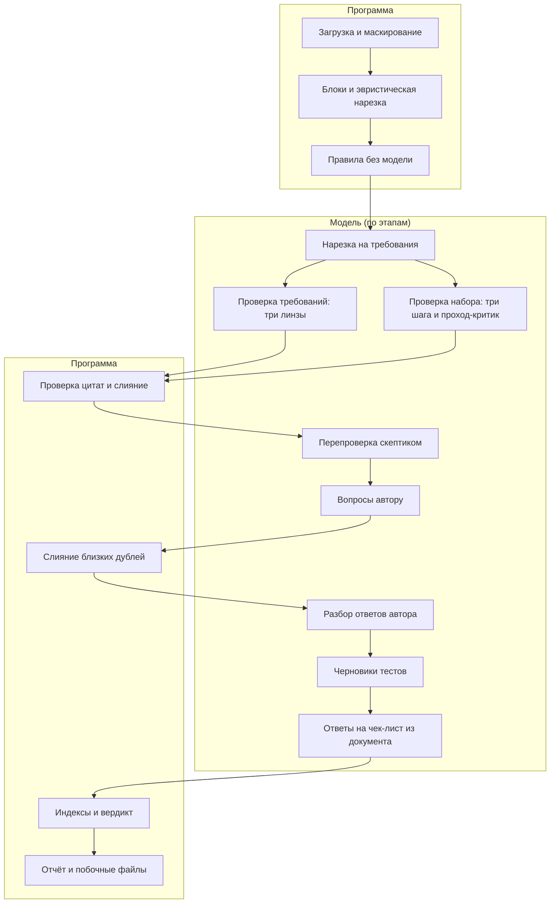
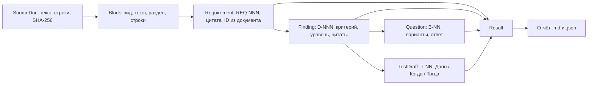
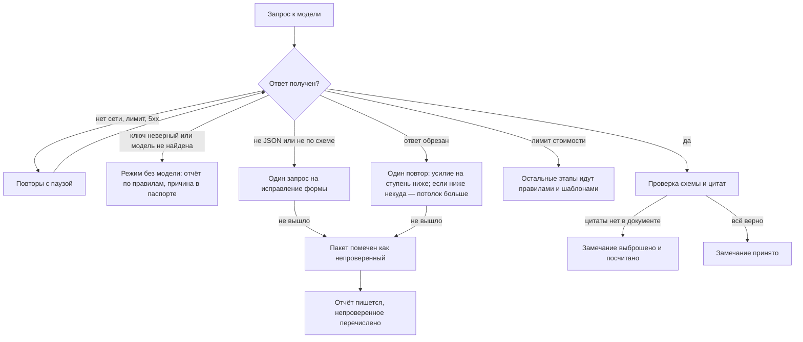
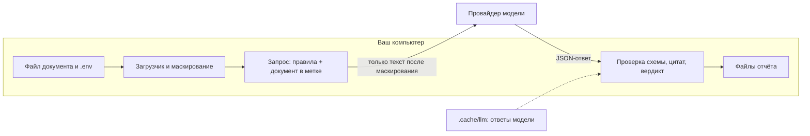

# Устройство «Ревизора ТЗ»

Документ для тех, кто хочет понять, как агент устроен и почему именно так. Как запустить — в [`README.md`](../README.md), все параметры и переменные — в [`USAGE.md`](USAGE.md).

Главная мысль: порядок шагов, цитаты, номера, индексы и вердикт ведёт программа. Модель даёт только то, что программа не умеет: смысловые замечания, вопросы, формулировки. Каждый её ответ проверяется, и любой её шаг можно заменить правилами.

## Карта модулей

| Модуль | Роль | Что получает и что отдаёт |
| :--- | :--- | :--- |
| `main.py`, `revizor/cli.py` | командная строка, коды возврата, запись файлов | аргументы → файлы отчёта; печатает ход работы |
| `config.py` | чтение `.env` (свой разбор), имена моделей по умолчанию, потолок цены | окружение → словарь настроек |
| `loader.py` | чтение `.md`, `.txt`, `.pdf`, `.docx`, `.html`; диагностика плохих файлов | путь → `SourceDoc` или `Diagnostic` |
| `privacy.py` | маскирование номеров карт, ИИН/БИН, адресов почты и телефонов в явной записи без изменения длины текста | текст → текст со звёздочками и список замен |
| `structure.py` | разбор текста на блоки (абзацы, пункты, строки таблиц, код) | `SourceDoc` → список `Block` с номерами строк |
| `slicer.py` | нарезка блоков на требования без модели; сборка нарезки модели | блоки → `Requirement`, `Skipped` |
| `rules/` | 27 основных правил и 8 слабых «наблюдений» (набор 1.1; число берётся из реестра `RULES`) | требования → `Finding` с точными цитатами |
| `gapcheck.py` | проход-критик «чего не хватает»: 35 контрольных вопросов как данные, разбор ответа модели, привязка клеток карты к замечаниям | ответ модели → `GapCell` и замечания с `gap_ids` |
| `impact.py` | что изменит ответ на вопрос: блокеры, вердикт и индекс без связанных замечаний | вопросы и замечания → `Question.impact` |
| `prompts.py` | системный запрос, запросы по этапам, схемы ответов, «линзы» | данные этапа → текст запроса и JSON-схема |
| `llm/` | единый интерфейс к провайдерам, повторы, разбор JSON, кэш на диске, цены | запрос → проверенный JSON и расход токенов |
| `quotes.py` | поиск цитаты в исходном тексте | цитата модели → точный отрывок документа или отказ |
| `merge.py` | замечания модели → проверенные замечания; слияние (одинаковые слова рядом, замечание модели внутри замечания правила); свёртка однотипных мелких замечаний «по нескольку утверждений в пункте» в одно; номера `D-…`; решения скептика | ответы модели → список `Finding` |
| `pipeline.py` | порядок этапов, запасные пути, журнал решений | путь к документу → `Result` |
| `answers.py` | разбор анкеты с ответами, диалог в терминале, применение ответов | анкета → ответы, закрытые замечания |
| `testgen.py` | черновики тестов без модели, слияние с тестами модели | требования, вопросы → `TestDraft` |
| `checklist.py` | поиск незаполненного чек-листа ревью в самом документе (без модели); применение ответов модели | блоки → `ChecklistItem`; ответ модели → «да / нет / нельзя определить» |
| `baseline.py` | сравнение с прошлым JSON-отчётом | старый отчёт → исправлено / осталось / новое |
| `score.py`, `verdict.py` | индексы ясности и готовности, вердикт | замечания → числа и код вердикта |
| `estimate.py` | оценка запросов, токенов и цены до запуска | документ → оценка, без вызова модели |
| `report_md.py`, `report_json.py`, `sidefiles.py` | отчёт, JSON-двойник, анкета, тесты, формулировки, таблица замечаний CSV | `Result` → тексты файлов |
| `rewrite_gate.py` | проверка предложенных формулировок «было → стало»: формулировка печатается, только если правит нужное место и не теряет и не выдумывает чисел и кодов | предложения модели → допущенные и отклонённые с причиной |
| `report_html.py` | Markdown-отчёт → одна HTML-страница без скриптов и внешних ресурсов | текст `.md` → текст `.html` |
| `consistency.py` | отчёт не противоречит себе: отметки, ясность, вердикт, приоритеты вопросов, сильные стороны, история уровня; проверка `check_consistency`; пересборка старого JSON-отчёта без модели — `tools/rerender.py` | `Result` → согласованный `Result` и список нарушений |
| `exports.py` | подробности проверки `*.details.md`, краткая сводка `*.summary.md`, импорт в трекер `*.jira.csv`, подробности прогона `*.diagnostic.md`, страница `*.html` (отчёт и подробности вместе) | `Result` → тексты файлов |
| `eval/` | оценка по ключам дефектов (агент ключи не читает) | JSON-отчёт + ключ → доли найденного |

## Конвейер: что делает программа, что модель



Без модели (`--provider offline` или нет ключа) стрелки идут напрямую от правил к программным этапам: нарезка эвристическая, вопросы строятся по шаблонам правил, перепроверка пропускается, тесты только программные, вердикт помечен предварительным. Ответ автора вариантом закрывает замечание, если вопрос составлен по шаблону этого замечания; ответ своими словами только записывается. Прогон занимает доли секунды и ничего не отправляет наружу.

Этапы модели: `slice`, `slice_rest`, `review_clarity`, `review_completeness`, `review_correctness` (при `--depth fast` один общий `review`), `set_consistency`, `set_completeness`, `set_standards`, `set_gaps` (проход-критик; идёт и при `--depth fast`; повторный запрос только по вопросам, на которые модель не ответила), `skeptic`, `questions`, `answers`, `tests`, `checklist` (только если в документе найден незаполненный чек-лист ревью; пункты по 25 за запрос). Пакеты требований (по 12, у Gemini по 40; меняет `LLM_BATCH_SIZE`) идут в пул запросов вместе с проверками набора. Число одновременных запросов задаёт `LLM_CONCURRENCY`: по умолчанию 4 у Claude и OpenAI, 1 у Gemini и Ollama. В режиме экономии нарезка идёт без модели, а шаги отправляются по ценности (см. «Сбои и запасные пути»).

## Модель данных



- `Quote` хранит исходный текст документа и его строки (и страницу для PDF), а не пересказ модели.
- `Finding` имеет область (`requirement` или `set`), один критерий, уровень, источник (`model`, `rule:<id>` или `both`), статус (`open`, `rejected`, `merged`) и признак `advisory` для слабых наблюдений.
- Идентификаторы `REQ-`, `D-`, `В-`, `Т-` выдаёт только программа. Для вопросов и тестов буквы русские.
- `Result` собирает всё, включая паспорт прогона (`RunInfo`) и журнал решений `audit`. Имена полей — часть публичного JSON, их не переименовывают.

## Сбои и запасные пути



- Повторы: сетевой сбой, лимит запросов или ошибка 5xx — до четырёх попыток с растущей паузой; если сервер просит ждать дольше 120 с, повторы прекращаются. Ответ не JSON или не по схеме — один запрос на исправление с перечнем ошибок; если и он не по схеме, шаг считается не ответившим. Такой шаг не роняет прогон: его часть делают правила, первый экран отчёта пишет «Модель не ответила на N шагов из M», а `<отчёт>.diagnostic.md` называет эти шаги.
- Gemini: при перегрузке (503) или кончившейся дневной квоте (429) агент один раз за прогон переходит на запасную модель (`GEMINI_FALLBACK_MODEL`, по умолчанию `gemini-flash-lite-latest`), повторяет на ней тот же запрос и остаётся на ней. Снятую с обслуживания модель (404) агент заменяет действующей из списка моделей.
- Любая внутренняя ошибка ловится на верхнем уровне. Результат — диагностический отчёт, а не обрыв с трассировкой.
- Нарезка: если модель не распределила часть блоков, делается второй запрос только по ним, остальное доделывает эвристика. Каждый блок попадает ровно в одно требование или в одну запись «не требование».
- Запись файлов идёт через временный файл и замену, поэтому прерванный запуск не оставляет полфайла.
- Режим экономии запросов (`LLM_ECONOMY=auto|on|off`, при `auto` включён только для Gemini: бесплатный уровень считает запросы и часто отвечает 503). У Gemini запросы и так идут по одному (`LLM_CONCURRENCY` по умолчанию 1). Нарезка идёт эвристикой без запроса к модели. Шаги проверки отправляются по ценности: противоречия между разделами, критик «чего не хватает», линзы «корректность» → «полнота» → «ясность», затем полнота и стандарты набора. Разбор ответов идёт в прежнем порядке, поэтому номера замечаний от этого не зависят. Шаги, на которые модель не ответила из-за временного сбоя (перегрузка, таймаут, лимит в минуту), повторяются один раз в том же порядке, если провайдер ещё может отвечать и потолок стоимости не достигнут. В журнале видны обе попытки; первая помечена `retried` и в счёт «модель не ответила на N шагов из M» не входит. Время ожидания перегруженного Gemini (`GEMINI_OVERLOAD_WAIT_S`, 600 с) делится: в первом круге один шаг тратит не больше шестой части остатка, повтор может взять остальное. У других провайдеров без `LLM_ECONOMY=on` ничего не меняется. Замер на бесплатном Gemini (документ организаторов, тег v1.1.1): 15 шагов модели, ответ на 14, 47 запросов, 7 мин 17 с; у основной модели кончилась дневная квота, работу сделала запасная; второй прогон с кэшем доделал оставшийся шаг за 4 с.
- `--max-cost`: перед каждым запросом программа сравнивает потраченное с потолком. Запрос, уже отправленный, доводится до конца, поэтому итог может немного превысить потолок. После потолка все следующие шаги модели пропускаются: перепроверки нет, вопросы строятся по шаблонам правил, тесты только программные, чек-лист из документа остаётся без ответов. Паспорт пишет об этом в списке «Предупреждения». Если цена модели неизвестна, предел применить нельзя, и об этом тоже предупреждает паспорт.
- `--estimate` считает число запросов, токены и цену без вызова модели (`estimate.py`): нарезка эвристикой, размер ответа по формам ответа, токены по числу букв (±25 %). Печатает вилку цены и предлагает `--max-cost`. Режим экономии оценка не учитывает: нарезку она считает запросом.

## Границы доверия



- Маскирование идёт в загрузчике, до любой обработки, и его нельзя отключить: номера карт (по алгоритму Луна), ИИН/БИН (по контрольной цифре), адреса почты (часть до «@», домен остаётся) и телефоны в явной записи. Длина текста не меняется, номера строк остаются верными. Имена, почтовые адреса и номера счетов не маскируются. Файлы `--context` маскируются так же.
- Наружу уходит только текст запроса (правила, документ после маскирования, файлы `--context`). Ключ уходит провайдеру. В отчёты и журналы ключ не попадает, из текстов ошибок он вырезается.
- Документ стоит в запросе между метками `<document-…>`, где суффикс — первые 8 символов SHA-256 документа. Это детерминированно (кэш продолжает работать), но автор документа не может подобрать метку заранее. Служебные теги в тексте обезвреживаются.
- Всё, что вернула модель, — недоверенный ввод: ответ проходит проверку схемы, цитаты сверяются с документом, уровни и ссылки на номера проверяются программой, неизвестные номера отбрасываются.
- У модели нет инструментов: она не читает файлы и не выходит в сеть.
- Журнал `audit` в JSON хранит хэши запросов и ответов, токены, время и решения программы. Текста документа там нет.

## Решения и причины

**Цитаты проверяет программа.** Модели выдумывают. Замечание без найденной цитаты не имеет права попасть в отчёт: читатель должен иметь возможность открыть строку документа и убедиться. Печатается всегда исходный отрывок, а не вариант модели. Совпадение допускает разницу в разметке и кавычках, а нечёткое совпадение (порог 0,90) заменяется текстом документа. Для очень коротких цитат (меньше 12 знаков) нечёткое совпадение выключено, потому что короткая фраза совпадает с чем угодно.

**Вердикт считает программа.** Вердикт — решение «начинать или нет», его нельзя доверять тексту, который мог быть подсказан документом. Правило простое и проверяемое: открытый CRITICAL даёт «нельзя», MAJOR даёт «после правок». Индекс готовности показывает объём работы, но вердикт не определяет.

**Все числа в отчёте считает программа.** Абзац с причиной вердикта пишет модель, и она может ошибиться в счёте (например, написать его до слияния повторов). Поэтому в запросе сказано не называть числа, а программа вырезает из абзаца каждое предложение, где число стоит рядом со словами «блокер», «замечание», «требование», «вопрос», «дефект». Впереди ставится предложение программы с точными числами (`verdict.guard_reason`).

**Шкала ясности.** Ясность требования = 10 − 6,5 за каждый блокер, − 2,5 за существенное, − 0,75 за мелкое замечание; замечания к набору, где требование названо, — с половинным весом; не ниже 1. Если у требования нет открытого блокера, ясность не ниже 4. Так полоса «в таком виде использовать нельзя» (ниже 4) достаётся только требованию с блокером, а один блокер сразу опускает требование в эту полосу (`score.py`).

**Замечание привязано только к своим требованиям.** Требование получает отметку ⚠️ и теряет ясность из-за замечания, только если модель назвала это требование для этого замечания или одна из проверенных цитат замечания лежит в строках требования. Повторы сливаются только при общем месте. Если в слиянии участвует замечание к набору (у него много мест), нужно ещё совпадение темы: главные цитаты пересекаются или похожи слова заголовка либо описания. При слиянии решает тема. Если оба замечания об одном и том же (тот же дефект виден из нескольких мест), выживший забирает все проверенные цитаты повтора, без дублей и по порядку документа, и те требования, которые модель или правило назвали для повтора. Если темы разные (например, перепроверка слила несвязанные замечания), выживший оставляет только цитаты там, где лежит он сам; остальные места идут в поле `see_also`, печатаются строкой «См. также» и отметок не ставят. Новая ссылка на требование не появляется только потому, что в нём лежит цитата. Первой на карточке стоит самая показательная цитата: строка, на которую указало правило кода, а если её нет — первая цитата самого выжившего. Замечание правила сворачивается в замечание модели только того же семейства, на том же месте и на ту же тему; из нескольких таких выбирается то, чьи заголовок или описание больше похожи на правило. Если на месте правила нет замечания на его тему, замечание правила остаётся отдельным.

**Три линзы вместо одного прохода.** Одному запросу трудно держать семь критериев. У каждой линзы своя инструкция с типичными плохими формулировками и случаями, когда замечание поднимать не надо: ясность (однозначность, атомарность, необходимость); полнота и проверяемость; корректность (непротиворечивость, реализуемость). Цена — втрое больше запросов на требования; `--depth fast` возвращает один общий проход.

**Скептик.** Второй независимый взгляд убирает часть ложных тревог: он может оставить, отклонить или объединить замечание. Замечания правил он отклонить не может, чтобы подсаженный текст не «уговорил» систему молчать.

**Усилие рассуждений по этапам.** Рассуждения оплачиваются как выход и занимают основную часть цены. Поиск противоречий между разделами выигрывает от глубины (`high`); остальные проверки набора, перепроверка и разбор ответов идут на `medium`; проверке требований, нарезке, вопросам и тестам хватает `low` (замер 25.11.2026: три линзы на `low` нашли те же дефекты, что на `medium`, при выходе на 29 % меньше; это один прогон, его файлов в репозитории нет). Значения по умолчанию заданы в `llm/base.py` (`STAGE_EFFORT`), переопределяются `ANTHROPIC_EFFORT` и `ANTHROPIC_EFFORT_STAGES`.

**Обрезанный ответ не оплачивается дважды.** Проверки набора сразу просят потолок 64 000 токенов. Если ответ всё же обрезан (рассуждения съели лимит), делается ровно один повтор с усилием на ступень ниже и тем же потолком; только если усилие уже `low` или не применяется у провайдера, повтор идёт с большим потолком. Ответ повтора пишется в кэш под исходным усилием, поэтому следующий такой же прогон берёт его из кэша. Явный `LLM_MAX_TOKENS` повтор отключает.

**Уровни критичности по закрытому списку.** CRITICAL ставится только по одному из пяти оснований (поле `blocker`: противоречие, основной сценарий, стандарт протокола, потеря денег или данных, нет обязательной части). Модель называет основание; CRITICAL без него программа понижает до MAJOR и пишет это в журнал (`critical_without_reason`) и паспорт. У замечаний правил основание задано таблицей в `merge.py`. Скептик не отклоняет замечания, которые лишь просят лишних подробностей, а понижает их до MINOR.

**Кэш на диске.** Ключ — хэш провайдера, модели, усилия и обоих текстов запроса. Повторный прогон того же документа бесплатен. При прогоне с ответами автора первый проход берётся из кэша, а к модели идёт новый этап `answers` (и этапы, чьи запросы изменились). Пишутся только проверенные ответы, запись атомарная. `--no-cache` пропускает чтение кэша, но свежие ответы в него пишет. Отказались от прогона без кэша: тот же документ стоил бы каждый раз заново, а шаги, не ответившие в первый раз, нельзя было бы доделать вторым дешёвым прогоном.

**Цена до запуска и потолок расхода.** `--estimate` показывает число запросов и вилку цены, `--max-cost` останавливает вызовы модели. Отказались от того, чтобы узнавать цену только после прогона: на глубокой модели прогон стоит доллары.

**Режим экономии для бесплатных уровней.** Отказались от того, чтобы слать все запросы сразу: бесплатный Gemini считает запросы в день и часто отвечает «перегружен». Поэтому самые ценные шаги идут первыми, нарезка без модели, сорвавшийся шаг повторяется один раз, есть запасная модель. Если квота кончится, недоделанными останутся менее ценные шаги, и отчёт их назовёт.

**Без фреймворков для агентов.** Стандартная библиотека Python, официальный пакет `anthropic` для Claude и `pypdf` для PDF. Отказались от готового фреймворка: лишние зависимости, а порядок шагов и проверки ответов всё равно пришлось бы писать самим.

**Правила общие, под документ не подгоняются.** В правилах и подсказках нет слов, номеров и значений какого-либо конкретного документа. Памятка для финансовых систем составлена по общим подсказкам организаторов (эфир, критерии) и по разбору их образца отчёта, поэтому счёт на документе организаторов — не слепая оценка. Правила ищут признаки класса дефектов (метод GET у изменяющего запроса, ошибка под кодом 200, разные единицы одной величины). Иначе измеренная точность ничего бы не значила на чужих документах. Поэтому оценка идёт и на слепых документах: их и ключи к ним составил отдельный ИИ-помощник, не видевший агента.

**Слабые правила — наблюдения.** Словарные правила с низкой точностью (отрицания, местоимения, «и/или») не могут блокировать работу: они показываются отдельным списком и не входят в индексы и вердикт.

**Проход-критик: ответ на каждый контрольный вопрос.** Линзы и проверки набора — свободный поиск: на каждом прогоне модель замечает разное подмножество одних и тех же типовых пробелов. Поэтому есть четвёртая проверка набора (`set_gaps`, `gapcheck.py`): модель обязана ответить на каждый из 35 закреплённых вопросов («не относится», «описано» с одной дословной цитатой, «пробел» с замечаниями) и перед ответом перечислить, что перебрала. Вопросы общие, ни одного слова конкретного документа. Программа проверяет ответ: на пропущенные вопросы — один повторный запрос, неизвестные номера выбрасываются, неподтверждённая цитата даёт «цитата не подтверждена», уровень замечания ограничен потолком вопроса и никогда не CRITICAL. Замечания пробелов идут в общий поток: сливаются с замечаниями других этапов на ту же тему, сворачиваются с правилами и проходят скептика; номер вопроса едет за выжившим замечанием (`Finding.gap_ids`). Вопросы об интерфейсе задаются, только если в документе есть описание HTTP-интерфейса; на вопросы, на которые отвечает правило кода (`flow-happy-path`, `api-reliability`, `title-mismatch`, `missing-ids`), открытое замечание правила даёт «пробел» в любом случае. Карта сама не меняет индексы и вердикт.

**Что изменит ответ — считает программа.** Для каждого вопроса программа убирает связанные с ним замечания и заново считает вердикт и индекс готовности (`verdict.py`, `score.py`). Внутри каждой группы приоритета вопросы идут по влиянию: сначала закрывающие больше блокеров, затем дающие больший прирост индекса.

**Чек-лист из документа — подсказка, а не подпись.** Многие шаблоны банка заканчиваются чек-листом ревью, где отметки не проставлены. Программа находит его сама, без модели: не меньше трёх идущих подряд строк таблицы или пунктов списка, в каждом из которых отметка не выбрана (оба варианта «Да / Нет» на месте, пустой квадратик «[ ]» или «☐», пустая ячейка под столбцом отметки). Модель отвечает на каждый пункт «да», «нет» или «нельзя определить по тексту» с одним предложением-основанием и номерами подтверждающих замечаний; несуществующие номера программа выбрасывает, пропущенный пункт получает «нельзя определить». Без модели, при сбое или при лимите стоимости пункты перечисляются без ответа. Ответы не меняют замечания, индексы и вердикт.

**Отчёт пишется всегда.** Модель недоступна, документ нечитаем, запись дополнительного файла не удалась: везде итогом является понятный файл с описанием, что произошло и что делать.

### Почему так и от чего отказались

| Решение | От чего отказались и почему |
| :--- | :--- |
| Вердикт, индексы и все числа в отчёте считает программа | Вердикт от модели. Модель может ошибиться в счёте, а текст документа может подсказать ей нужный ответ |
| Цитату проверяет программа; замечание без найденной цитаты выбрасывается | Доверять цитате модели. Модели выдумывают, а читатель должен открыть строку и убедиться |
| Три узкие линзы, проходы по набору, критик и скептик | Один большой запрос. Одному запросу трудно держать семь критериев; скептик убирает часть ложных тревог, но находку правила отклонить не может |
| Каждый ответ модели проверяется по схеме; при ошибке — один запрос на исправление. Сколько шагов не ответило, сказано на первом экране отчёта, какие именно — в `<отчёт>.diagnostic.md` | Молча терять шаг. Читатель должен знать, что не проверено |
| Кэш ответов модели на диске (`.cache/llm/`) | Платить заново за тот же документ. Повторный прогон и прогон с ответами автора берут готовое |
| Оценка цены до запуска (`--estimate`) и потолок расхода (`--max-cost`) | Узнавать цену после прогона. После потолка модель не вызывается, остальное делают правила |
| Режим экономии для бесплатных уровней (`LLM_ECONOMY`, для Gemini включён сам) | Слать все запросы сразу. Бесплатный уровень считает запросы и часто отвечает «перегружен» |
| Без фреймворков для агентов: стандартная библиотека Python, официальный пакет `anthropic` для Claude и `pypdf` для PDF | Готовый фреймворк. Лишние зависимости, а порядок шагов и проверки всё равно пришлось бы писать самим |

## Как расширять

**Добавить правило.**

1. В `revizor/rules/__init__.py` добавьте `RuleInfo` в словарь `RULES`: идентификатор, критерий, уровень по умолчанию, область (`requirement` или `set`), название; для слабого правила `advisory=True`.
2. В подходящем файле (`text_rules.py`, `set_rules.py`, `api_rules.py`, `safety_rules.py`, `advisory_rules.py`) напишите функцию `rule_x(ctx, rule)`, возвращающую список `Finding` с точными цитатами, и добавьте её в словарь файла. Проверка при импорте требует, чтобы описания и реализации совпадали.
3. Напишите тест в `tests/test_rules.py`: срабатывание на коротком примере и молчание на нормальном тексте.

**Добавить провайдера.**

1. Создайте класс-наследник `Backend` из `llm/base.py` и реализуйте `_raw(system, user, max_tokens, *, effort=None)`, возвращающий текст и `Usage`. Повторы, разбор JSON, проверка схемы, кэш и счётчики уже в базовом классе.
2. Добавьте имя в `PROVIDERS` и ветку в `make_backend` (`llm/__init__.py`), модель по умолчанию в `config.py`, цену в `llm/pricing.py`.
3. Проверьте провайдера с заглушкой вместо сервера, как в `tests/test_llm_http.py`.

**Добавить раздел отчёта.**

1. Напишите функцию раздела в `report_md.py` и добавьте её в список в `render`.
2. Если раздел нужен машине, добавьте поле в `report_json.summary`.
3. Проверьте в `tests/test_report.py`, что числа в шапке, в сводке и в JSON совпадают, а ссылки ведут на существующие якоря.

## Тесты

718 тестов, без сети и без ключей:

```bash
python -m unittest discover -s tests -t .
```

Провайдеры проверяются с заглушкой вместо сервера. Живьём агент работал на Anthropic (Opus и Haiku) и на бесплатном уровне Gemini. OpenAI-совместимые серверы и Ollama проверены только тестами с заглушкой.
