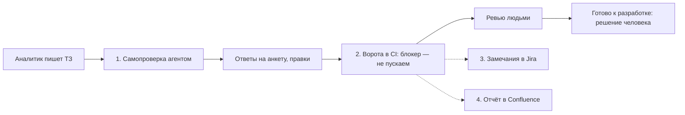

# Как встроить в процесс банка

Четыре места в процессе, где агент полезен, и две петли работы с автором документа. Для каждого места — точная команда и что получает человек. Все флаги взяты из `python main.py --help`; полный список — в разделе «Все параметры запуска» файла [`USAGE.md`](USAGE.md).

Ниже `<документ>` — путь к файлу с требованиями (`.md`, `.txt`, `.pdf`, `.docx`, `.html`), `<отчёт>` — путь к отчёту без расширения. Рядом с `<отчёт>.md` агент всегда пишет `<отчёт>.json` и `<отчёт>.html` (тот же отчёт одной страницей для браузера). Если документ прочитан, ещё `<отчёт>.summary.md` (одна страница: вердикт, блокеры, первые вопросы) и `<отчёт>.diagnostic.md` (подробности прогона: какие шаги модели не ответили, что отброшено). При наличии содержимого — `<отчёт>.questions.md` (анкета вопросов автору), `<отчёт>.tests.md` (черновики приёмочных тестов), `<отчёт>.findings.csv` (замечания таблицей), `<отчёт>.jira.csv` (те же замечания для импорта в Jira) и `<отчёт>.fixed.md` (предложенные формулировки, с моделью или после ответов). Всего до десяти файлов, включая сам отчёт; подробно — в [`USAGE.md`](USAGE.md).



## 1. Самопроверка аналитика до отправки на ревью

Аналитик проверяет свой документ сам, до того как отдать его коллегам. Так очевидные дефекты не доходят до встречи ревью.

```bash
python main.py --input <документ> --output <отчёт>.md
```

Без ключа модели или если документ нельзя отправлять наружу:

```bash
python main.py --input <документ> --output <отчёт>.md --provider offline
```

Что получает аналитик: отчёт с вердиктом и списком блокеров в начале, замечания с цитатой и номером строки, анкету вопросов `<отчёт>.questions.md`. Без модели ищутся только формальные дефекты (размытые слова, заглушки, ошибки HTTP-интерфейса, пустые разделы), и вердикт помечен предварительным. Перед платным прогоном полезно посмотреть цену: тот же вызов с `--estimate` модель не вызывает.

## 2. Ворота в конвейере сборки, если требования лежат в репозитории

Правило: «документ с блокером в разработку не пускаем». Агент запускается при каждом изменении документа и роняет проверку, если найден блокер.

```bash
python main.py --input <документ> --output <отчёт>.md --provider offline --fail-on critical
```

Коды возврата:

| Код | Значение |
| :--- | :--- |
| 0 | отчёт записан, порог `--fail-on` не достигнут. При `--fail-on never` сюда же попадает нечитаемый документ с диагностическим отчётом |
| 1 | неверные параметры, отчёт записать не удалось или запуск прерван |
| 3 | достигнут порог `--fail-on`: есть открытые дефекты уровня `critical` (или `major` при `--fail-on major`) |
| 4 | задан `--fail-on critical` или `major`, а документ не прочитан (скан без текста, битый или пустой файл); диагностический отчёт записан |

Для ворот нечитаемый документ — тоже «не готов», поэтому с `--fail-on` агент сам возвращает 4. Пример для GitLab вдобавок проверяет поле `diagnostic` в `<отчёт>.json` и тоже возвращает 4, если оно не пустое.

Готовые примеры:

- GitHub Actions — [`docs/ci-example.yml`](ci-example.yml);
- GitLab CI — [`docs/ci-gitlab-example.yml`](ci-gitlab-example.yml). Банки часто держат GitLab или Jenkins на своих серверах; для Jenkins нужен тот же сценарий оболочки в шаге `sh`.

Оба примера по умолчанию работают без модели: бесплатно, без ключей, текст документа никуда не уходит. Отчёты сохраняются как артефакт сборки, их видно и при упавшей проверке. Вариант с моделью закомментирован: ключ — только в секретах или защищённых переменных CI, плюс потолок цены `--max-cost`.

Что получает команда: merge request с блокером не проходит проверку, а в артефактах лежит отчёт с объяснением, что исправить первым.

## 3. Замечания в Jira

Готовый файл для импорта — `<отчёт>.jira.csv`: по строке на открытое замечание, столбцы `Summary`, `Description`, `Priority`, `Labels`, `Issue Type`. В `Summary` — уровень и название замечания, в `Description` — проблема, требования, цитаты со строками, как исправить и связанный вопрос автору. `Priority`: CRITICAL → Highest, MAJOR → High, MINOR → Low. `Labels`: `revizor`, критерий и номер замечания. `Issue Type` — `Bug`. Кодировка UTF-8 с меткой BOM, строки разделены CRLF. При импорте остаётся сопоставить столбцы с полями Jira один к одному.

Если нужна своя раскладка полей, есть `<отчёт>.findings.csv`: одна строка на открытое замечание (наблюдения слабых правил в файл не попадают). Кодировка UTF-8 с меткой BOM, разделитель — запятая. Если замечаний нет, файла нет. Ячейки, которые начинаются с `=`, `+`, `-`, `@`, агент предваряет апострофом, чтобы таблица не приняла их за формулу.

Столбцы:

| Столбец | Что внутри |
| :--- | :--- |
| `id` | номер замечания в отчёте, `D-…` |
| `severity` | `CRITICAL`, `MAJOR` или `MINOR` |
| `blocker_reason` | основание блокера (только у CRITICAL): `contradiction`, `main_flow`, `protocol`, `loss`, `missing_part` |
| `criterion` | критерий качества, например `unambiguity`, `set_consistency` |
| `scope` | `requirement` — к одному требованию, `set` — к документу целиком |
| `requirement_ids` | номера требований в отчёте, `REQ-…`, через `; ` |
| `doc_ids` | номера требований в самом документе, если они есть |
| `lines` | строки документа |
| `title` | короткое название замечания |
| `problem` | в чём проблема |
| `recommendation` | как исправить |
| `quote` | дословная цитата из документа (несколько — через ` \| `) |
| `question_id` | номер связанного вопроса автору, `В-…` |

**Как импортировать `findings.csv` со своей раскладкой.**

1. Подготовить описание. Импорт Jira обычно кладёт в «Описание» один столбец, поэтому удобно заранее собрать его из трёх. Откройте CSV в таблице и добавьте столбец `description` с формулой (столбцы по порядку: `problem` — J, `recommendation` — K, `quote` — L):
   `=J2 & CHAR(10) & "Цитата: " & L2 & CHAR(10) & "Как исправить: " & K2`
   Сохраните снова как CSV в UTF-8.
2. В Jira откройте импорт задач из CSV. Названия пунктов меню зависят от версии и прав: в Jira Cloud это импорт задач из CSV в разделе работы с задачами, в Jira Data Center — «External System Import» → CSV у администратора.
3. Сопоставьте поля:

| Поле Jira | Столбец CSV |
| :--- | :--- |
| Summary (название) | `title` (можно с префиксом `id`: «D-012 …») |
| Description (описание) | `description` из шага 1 (= `problem` + `quote` + `recommendation`) |
| Priority (приоритет) | `severity`: при импорте задайте соответствие значений, например CRITICAL → Highest, MAJOR → High, MINOR → Low |
| Labels (метки) | `criterion`; постоянную метку вроде `revizor` добавьте вторым столбцом с одинаковым значением |
| свободное поле или комментарий | `id`, `lines`, `requirement_ids`, `question_id` — чтобы найти замечание в отчёте |

4. Задачи для MINOR заводить необязательно: их можно отфильтровать в таблице до импорта.

После правок документа повторная проверка с `--baseline` (см. ниже) покажет, какие замечания исправлены; закрывать задачи в Jira нужно вручную — сам агент в Jira не пишет.

## 4. Отчёт в Confluence

Отчёт — обычный Markdown. Его можно вставить на страницу через макрос Markdown (если он есть в вашей версии Confluence; если нет — спросите администратора о подходящем приложении).

Что вставлять:

- **в начало страницы как краткое содержание** — `<отчёт>.summary.md`: одна страница с вердиктом, блокерами и первыми вопросами автору. Если нужно подробнее — шапку отчёта до раздела «1. Паспорт прогона», раздел «6. Итог» (вердикт, причина, что исправить в первую очередь) и раздел «7. Уточняющие вопросы к автору ТЗ»;
- **полный отчёт** — во вложение страницы: `<отчёт>.md` или `<отчёт>.html` (одна страница, открывается без интернета, печатается в PDF).

Внутренние ссылки отчёта сделаны якорями HTML (`<a id="…">`). В Confluence они могут не работать, это на смысл отчёта не влияет. Агент сам в Confluence не публикует.

## Петля 1: ответы автора на вопросы

Это главная петля для уточнения требований. Агент пишет анкету `<отчёт>.questions.md`: вопрос, цитата, варианты ответа и пустая строка «Ответ:». Вопросы разделены на блокирующие, важные и желательные; у каждого указано, что изменит ответ в итоге.

Автор заполняет анкету (буквой варианта или своими словами) и запускает проверку снова. Команда напечатана в конце анкеты:

```bash
python main.py --input <документ> --output <отчёт>.md --answers <отчёт>.questions.md
```

С моделью агент разбирает ответы, отмечает закрытые замечания, предлагает новые формулировки в `<отчёт>.fixed.md` и показывает два вердикта: по документу как есть и после внесения ответов. Без модели ответ записывается рядом с вопросом. Выбранный вариант закрывает замечание, если вопрос составлен по шаблону этого замечания; ответ своими словами только записывается, и замечание остаётся открытым. При прогоне с моделью первый проход берётся из кэша ответов на диске (`.cache/llm/`), к модели идёт в основном разбор ответов, поэтому такой прогон дешевле первого.

Вопросы можно задать и прямо в терминале, по одному, до 7 штук, сначала блокирующие:

```bash
python main.py --input <документ> --output <отчёт>.md --interactive
```

Без терминала (например, в CI) этот режим выключается сам.

## Петля 2: повторная проверка после правок

Автор исправил документ. Сравнение с прошлой проверкой:

```bash
python main.py --input <документ_v2> --output <отчёт_v2>.md --baseline <отчёт>.json
```

В отчёте появится строка «С прошлой проверки»: сколько замечаний исправлено, сколько осталось, сколько новых. Совпадение ищется по правилу или критерию и по пересечению цитат. Изменённый документ модель проверяет заново, поэтому прогон с моделью стоит примерно как первый.

## Кто за что отвечает

| Шаг | Кто | Что решает человек |
| :--- | :--- | :--- |
| Самопроверка | автор документа | какие замечания принять, что ответить в анкете |
| Ворота в CI | владелец репозитория требований | порог (`critical` или `major`), модель или без модели |
| Jira | аналитик или руководитель ревью | какие замечания заводить задачами |
| Confluence | автор документа | что показать на странице |
| Готово к разработке | руководитель ревью | окончательное решение; отчёт агента — подсказка, не подпись |
